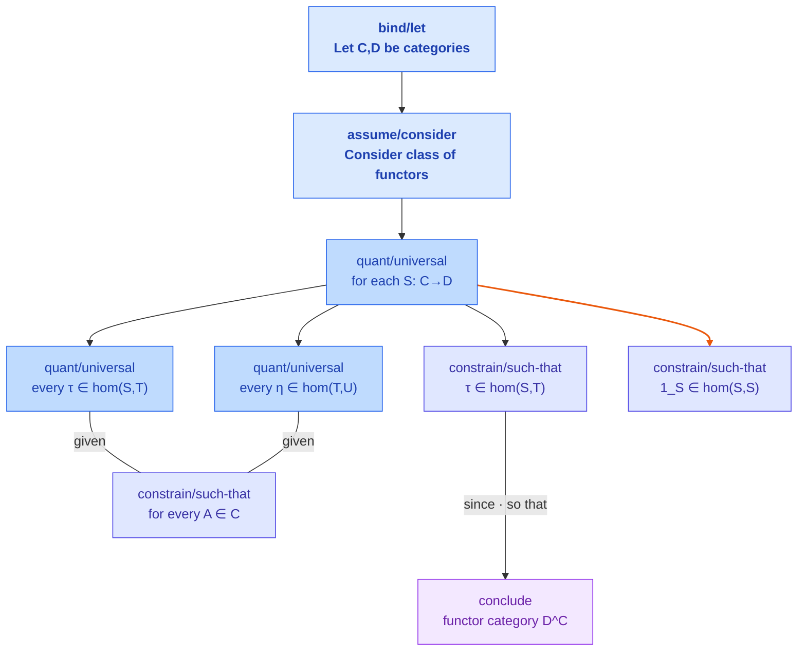
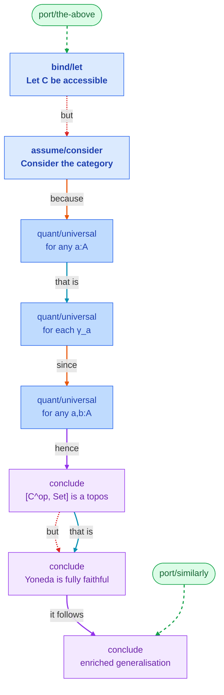

# Futon Evidence Pack

Generated: 2026-02-25 14:05:32Z

## futon1a

### README.md

# futon1a

Ground-up reconstruction of futon1, built as a demonstration of futonic best
practices. Storage layer with unbreakable core invariants.

## Dual Goals

1. **Product**: A storage layer where persistence, identity, and integrity are
   guaranteed by design, not hope.
2. **Process**: Demonstration of pattern-based design with full traceability
   from theory to code to test.

## Core Invariants

| Layer | Invariant | Statement |
|-------|-----------|-----------|
| I0 | Persistence | What you save is what you get back |
| I1 | Identity | One entity per identity, no ambiguity |
| I2 | Integrity | Startup succeeds completely or fails loudly |
| I3 | Hierarchy | Errors surface at the layer that caused them |
| I4 | Debugging | Any bug diagnosable in under 10 minutes |

## Architecture

```
Layer 4: Model Validation     ─── 400 Bad Request
    ↑
Layer 3: Authorization        ─── 403 Forbidden
    ↑
Layer 2: Integrity            ─── 500 Internal Error
    ↑
Layer 1: Identity             ─── 409 Conflict
    ↑
Layer 0: Durability           ─── 503 Unavailable
```

Each layer is a gate. If Layer N fails, Layers N+1 never run.

## Pattern Grounding

Every module traces to:
- **Theory pattern** (abstract, from `futon3/library/futon-theory/`)
- **Storage pattern** (concrete, from `futon3/library/storage/`)
- **Git evidence** (commits that drove the design)

See: `futon3/holes/missions/M-futon1a-rebuild.md`

## Development

Built with PSR/PUR discipline:
- Every design decision has a Pattern Selection Record
- Every implementation has a Pattern Use Record
- Records stored in `futon3/holes/labs/futon1a/`

## Status

🚧 **In Development** - Part I (Process) phase

## References

- Mission: `futon3/holes/missions/M-futon1a-rebuild.md`
- Work Plan: `futon3/holes/missions/M-futon1a-workplan.md`
- Evidence: `futon3/holes/missions/M-futon1a-evidence.md`
- Theory: `futon3/library/futon-theory/`
- Storage Patterns: `futon3/library/storage/`


## futon2

### README.md

# clj-ants-aif

An experiment in active inference ants battling the classic Rich Hickey ruleset. Two hives spawn on opposite corners of a grid and compete for food while adapting via predictive coding, hunger dynamics, and expected free-energy minimisation.

## Getting Started

Clone the repo and make sure you have [Clojure CLI tools](https://clojure.org/guides/getting_started) installed. Everything else comes from `deps.edn`.

```bash
git clone https://github.com/ants/clj-ants-aif.git
cd clj-ants-aif
```

### Run the war sim

```bash
# default scenario (mirrored hives, ~200 ticks)
clj -M:run

# override total ticks from the CLI (e.g. 50 ticks)
clj -M:run 50
```

Each tick prints a HUD line with the classic vs AIF score, tick counter, an EMA of the AIF expected free energy, and hive reserves (a running food bank for each colony). The tail of the line highlights the most recent action per army plus a termination banner when starvation ends the match. For programmatic control, start a REPL (`clj`) and drive the pure API:

```clojure
(require '[ants.war :as war])

;; customise any `war/default-config` keys
(def world (war/run {:size [32 32]
                     :ants-per-side 10
                     :ticks 150}))

;; or iterate silently without HUD output
(def final (war/simulate {:ticks 300 :ants-per-side 8}
                         {:hud? false}))
```

### Unit tests

```bash
clj -M:test -m cognitect.test-runner
```

Covers observation, predictive coding, policy selection, world bootstrapping, and run-loop sanity checks. The alias launches the Cognitect test runner so you can re-run individual namespaces when iterating.

### Benchmarks

```bash
clj -M:bench
```

Times three preconfigured grids (5×5, 25×25, 100×100) and writes `out/bench.csv` with scores, duration, and Δscore. Edit `ants.bench/scenarios` to add or tweak variants before re-running the alias.

### Visualizer

```bash
clj -M:viz
```

Opens a Swing window that animates the war simulation using the same world state as the CLI loop (AIF ants in red, classic in charcoal, food in orange, pheromones in green, fallen ants marked with an X at their death spot). The `clj -M:viz` alias prints a scoreboard update to STDOUT every few ticks so you can see progress even when the window steals focus. Pass an integer to the alias (e.g. `clj -M:viz 20`) to change the logging cadence. From a REPL you can customise everything:

```clojure
(require '[ants.visual :as viz])

(viz/visualize {:size [40 40]
                :ants-per-side 12
                :ticks 400}
               {:delay-ms 60   ;; frame delay
                :log? true     ;; print scoreboard lines to the REPL
                :log-every 10  ;; log once every 10 ticks
                :blocking? false})
```

The non-blocking form returns handles to the frame and world atom so you can inspect state while the animation runs.

## Architecture Notes

- **AIF Core**: `ants.aif.core/aif-step` orchestrates observe → perceive → policy. It stays pure and returns diagnostics (`G`, `P`, trace data).
- **Observe**: `ants.aif.observe/g-observe` normalises local food, pheromone, and home proximity channels into `[0,1]` evidence vectors.
- **Perceive**: `ants.aif.perceive/perceive` runs capped predictive-coding micro-steps, adjusts hunger, and anneals action temperature via `ants.aif.affect`.
- **Policy**: `ants.aif.policy/choose-action` evaluates abstract actions by one-step expected free energy and samples a softmax using precision-driven `tau`.
- **Scenario**: `ants.war` wires mirrored hives, food gradients, pheromone evaporation, and handles classic vs. AIF action dispatch.
- **UI**: `ants.ui` exposes a terminal-friendly scoreboard and HUD helpers; rendering stays outside the AIF modules for purity.

Refer to `AGENTS.md` for an agent-state contract and helper semantics.

Observation vector ordering (the `sense->vector` ABI):

```clojure
[:food :pher :food-trace :pher-trace :home-prox :enemy-prox :h :ingest
 :friendly-home :trail-grad :novelty :dist-home :reserve-home :cargo]
```

Note: the observation map also carries `:hunger`, `:recent-gather`, and `:white?`
keys; the vector ABI intentionally omits those extras.

## Devmap

The prototype roadmap lives in `../futon3/holes/futon2.devmap`. This README
tracks the runnable entry points and architecture notes that back the devmap.

### Cyber-AIF Armies

You can now swap the classic faction for Futon3-derived cyber-ants. The Futon5
`cyber_ants` operator reads pattern descriptions under `futon3/library/ants/`
and emits configs Futon2 applies on a per-ant basis. Configure the matchup via
`war/run` or the CLI:

```clojure
(war/run {:armies [:cyber :aif]
          :cyber {:pattern :cyber/white-space-scout}
          :ants-per-side 6})
```

Cyber ants reuse the AIF brain but carry pattern-specific `:aif-config` data,
so you can flash alternative behaviour (baseline, white-space scout, hunger ↔
precision coupling) without editing the simulation code. The HUD, scoreboard,
and Swing visualizer automatically display whichever species you choose.

## Configuration

`ants.war/default-config` covers grid size, food/pheromone caps, agents per side, EMA smoothing, tick count, and the hunger system. Override keys via the map passed to `war/run` or CLI args (ticks shorthand).

### Hunger & Hive Reserves

Every ant carries a hunger drive `h ∈ [0,1]`. Metabolic burn, carrying load, and distance from home push hunger up; gathering or depositing food, plus resting on the nest, pull it down. Key knobs live under `:hunger`:

| Key                                            | Meaning                                                                                                                                                                                                    |
|------------------------------------------------|------------------------------------------------------------------------------------------------------------------------------------------------------------------------------------------------------------|
| `:initial`                                     | Baseline hunger for newborn ants (`0.36` by default).                                                                                                                                                      |
| `:burn`, `:feed`, `:rest`, `:load-pressure`    | Coefficients passed to `affect/tick-hunger` controlling metabolism, food relief, nest comfort, and cargo stress.                                                                                           |
| `:gather-feed`, `:deposit-feed`, `:home-bonus` | Post-action offsets applied when an ant gathers, deposits, or rests at home.                                                                                                                               |
| `:death-threshold`                             | Hunger level that triggers starvation death (`0.995`).                                                                                                                                                     |
| `:queen`                                       | Hive-wide fuel store: `:initial` reserve, base `:burn`, per-ant `:per-ant` upkeep, `:starvation-grace` ticks tolerated at zero, and `:starvation-boost` applied to worker hunger once the pantry is empty. |

Reserves appear in the HUD as `Hive C:## A:##`. When harvest stalls, reserves tick down each turn; once a hive runs dry for longer than its grace period the simulation halts with an `END queen-starved(...)` marker. If every worker dies first you will instead see `END all-ants-dead`. Should Alice fall in battle the run stops immediately with `END alice-dead` and the CLI prints `Game Over (Alice Died)`.

## License

Eclipse Public License (EPL) 1.0. See `LICENSE` for details.


## futon3

### README.md

# futon3 — Interface Layer

futon3 is the central coordination layer of the futon stack. It hosts MUSN
(the session/transport protocol), the canonical pattern library (flexiargs +
sigils), and Agency (multi-agent coordination). All other futons route through
futon3 for pattern lookup, session management, and inter-agent communication.

> **Stack context**: futon0/1/2 provide data and experiments -> **futon3
> coordinates** -> futon4/5 consume patterns and scholia. See
> `../futon0/README.md` for the full stack diagram.

---

A modern Clojure rewrite of the vintage Monster Mountain / MUSN server. The transport provides a battle-tested ingest path plus an **optional** multi-user REPL (SAFE via SCI, ADMIN via tokenized unsafe eval) while we wait to slot in an external persistence layer. Futon3 is also the canonical interface layer: shared ChatGPT/tatami shims (e.g. `contrib/aob-chatgpt.el`), pattern libraries, and sigil tooling live here so every other futon, including Futon1 storage, depends on a single point of integration.

## Prerequisites
- JDK 11+ and `clojure` CLI tools (`brew install clojure/tools-deps` or similar)
- Network access the first time you run `make test`/`make dev` so dependencies can be cached into the repo-local `.m2/` directory

## Layout Highlights
- `src/f2/transport.clj` – WebSocket/HTTP bus, async back-pressure, optional REPL wiring
- `src/f2/repl.clj` – SAFE (SCI sandbox) + ADMIN (token-gated) evaluators
- `src/f2/ui.clj` – JSON facade (`/musn/clients`, `/musn/sessions`, `/musn/practices`, `/musn/export`)
- `src/f2/musn.clj` – system lifecycle + demo ingest hooks
- `src/f2/semantics.clj` – placeholder reasoning over transport history
- `dev/demo_events.ndjson` – sample ingest for `make demo`

## MUSN + HUD (fubar/fucodex) Quickstart
To run a MUSN-guided fucodex session with live HUD in Emacs:

1. Start MUSN HTTP (6065):
   ```bash
   clojure -M -m futon3.musn.http
   # MUSN HTTP server on 6065
   ```
2. Start drawbridge + transport/UI (6767/5050/6060):
   ```bash
   ADMIN_TOKEN=$(cat .admintoken) FUTON3_DRAWBRIDGE=1 ./scripts/dev.sh
   # Drawbridge on http://127.0.0.1:6767/repl ...
   # Transport on 5050, UI on 6060
   ```
3. In Emacs, run:
   ```elisp
   M-x fubar-musn-launch-and-view
   ;; enter your prompt/intent when prompted
   ```
   This opens a 2-up view (raw stream + HUD). HUD stays in sync with MUSN intent/session/sigils and shows pattern candidates + AIF suggestion. Click "Proceed" in the HUD to continue the run.

Port map (defaults):
- Drawbridge (nREPL over HTTP): 6767
- Transport/HUD format: 5050 (`HUD_SERVER`)
- UI + pattern-action RPC: 6060 (`FUTON3_CODEX_SERVER_URL`)
- MUSN HTTP: 6065 (`FUTON3_MUSN_URL`)
- MUSN IRC bridge: 6667 (`scripts/musn_irc_bridge.clj`)

## Quick Start
1. Install deps (first run populates `.m2/`):
   ```bash
   make test
   ```
2. Boot the stack:
   ```bash
   make dev
   ```
   - Transport (WS+HTTP) -> `http://localhost:5050`
   - UI endpoints -> `http://localhost:6060`
   - MUSN HTTP -> `http://localhost:6065`
3. (Optional) Load sample events:
   ```bash
   make demo
   # streams dev/demo_events.ndjson via the ingest path
   ```

## Fuclaude / Fucodex Usage

Use `fuclaude` and `fucodex` instead of raw `claude` / `codex` to get automatic session logging, pattern context injection, and audit trails.

### Common invocations

```bash
# Basic usage (replaces `claude -p "task"`)
./fuclaude --live -p "Fix the bug in parser.clj"

# Basic usage (replaces `codex exec "task"`)
./fucodex --live exec --prompt "Add unit tests for the API"

# With full MUSN tracking (recommended for important work)
./fuclaude --musn --live -p "Implement the new feature"
./fucodex --musn --live exec --prompt "Refactor authentication"

# Resume a previous session
./fuclaude --resume <session-id> -p "Continue from where we left off"
./fucodex --live resume --last "Continue work"

# Interactive mode with AIF pattern guidance
./fucodex --cli --with-aif
```

### What you get

- **Session logs**: `lab/raw/`, `lab/trace/`, `lab/stubs/`
- **Pattern context**: HUD injects relevant patterns into prompts
- **PSR/PUR capture**: Pattern Selection Records and Pattern Use Records
- **AIF scoring**: Adaptive scoring of pattern candidates
- **Intent extraction**: Automatic intent parsing for audit trails

### Shell aliases (optional)

Add to your `.bashrc` or `.zshrc`:

```bash
alias fc='cd /home/joe/code/futon3 && ./fuclaude --live -p'
alias fcm='cd /home/joe/code/futon3 && ./fuclaude --musn --live -p'
alias fx='cd /home/joe/code/futon3 && ./fucodex --live exec --prompt'
alias fxm='cd /home/joe/code/futon3 && ./fucodex --musn --live exec --prompt'
alias fxi='cd /home/joe/code/futon3 && ./fucodex --cli --with-aif'
```

## Elisp Package Tests
Use the package runner to target individual Elisp test files:
```bash
./scripts/test-elisp-packages.sh embedding
./scripts/test-elisp-packages.sh hud sessions
PACKAGE=bridge ./scripts/test-elisp-packages.sh
```
Supported packages: `embedding`, `hud`, `sessions`, `arxana`, `bridge`, `aob`, `all`.

## Devmap PDF (A3)
We keep the seven futon devmaps in `artifacts/devmaps.tex`. To regenerate the emoji-rich A3 PDF:
```bash
scripts/build_devmaps.sh
```
The script regenerates `holes/artifacts/devmaps.tex` via `scripts/make_devmaps_tex.py`, then runs lualatex inside `holes/`.

For focused views, generate per-futon zoomed artifacts:
```bash
scripts/build_devmaps_zoom.sh          # builds futon0..futon7 focused PDFs
scripts/build_devmaps_zoom.sh 3 f5     # builds futon3 + futon5 only
```
This writes `holes/artifacts/devmaps-futonN.pdf` plus per-view dependency graphs.

## Vitality Feeds (git activity)

FUTON0 collects raw git stats via `scripts/git_activity.py`. Futon3 then converts that JSON into a HUD-friendly EDN snapshot:

```bash
clojure -M:vitality/git-summary
# writes resources/vitality/git_summary.edn
```

Load the summary in code via `futon3.vitality.git` -- it exposes helpers such as `load-summary`, `daily-grid`, `streak`, and `dominant-sphere`.

## Running Tests
```bash
make test
```
Runs Datascript fixture tests, semantics checks, and transport/REPL dispatch tests.

### Emacs Test Tips
`scripts/test-elisp.sh` runs the chatgpt-shell HUD suite. To keep it gentle on memory:
- limit the scope with `ERT_SELECTOR`, e.g. `ERT_SELECTOR='futon3-prototype-*' ./scripts/test-elisp.sh`
- cap virtual memory when running the full suite: `ulimit -v 2097152 && ./scripts/test-elisp.sh`

## Additional Documentation

For detailed documentation on specific subsystems, see:

| Document | Topics |
|----------|--------|
| `README-musn-transport.md` | IRC Bridge, Chat Supervisor, WebSocket protocol, Drawbridge, HTTP ingest, UI routes |
| `README-tatami.md` | Tatami HUD, cue embeddings, intent sigil lifecycle, paramitas |
| `README-patterns.md` | Sigil adjacency builder, pattern embeddings CLI, Futon1 ingestion |
| `README-proofwork.md` | Transport contract, pattern canon, check DSL, trail instrumentation, workday bridge |
| `README-drawbridge.md` | Detailed nREPL-over-HTTP setup and remote access |

## Next Steps
- Swap the Datascript placeholder with the upcoming external graph/persistence package
- Expand the `musn.api` DSL surfaced to SAFE evals (graph queries, semantic helpers, etc.)
- Layer auth/tooling on top of the `eval` frame (CLI helpers, per-token quotas, observability)


### docs/pattern-competence/README.md

# Pattern Competence Pipeline (Fulab)

This pipeline records pattern competence in two linked records:
- PUR (Pattern Use Record): retrospective, auditable use of a pattern.
- PSR (Pattern Selection Record): prospective, auditable selection among patterns.

Records are stored as append-only events in `lab/sessions/<session-id>.edn` and
verified via `futon3.hx.logic` step kinds.

## Schemas (EDN examples)

### Anchor

```edn
{:anchor/type :code/edit
 :anchor/ref {:event/type :code/edit
              :file "src/f2/claude.clj"
              :fn "start-session!"}}
```

Anchors must resolve to at least one session `:events` entry.

### Certificate

```edn
{:certificate/type :git/commit
 :certificate/ref "59ecb34"
 :certificate/repo "/home/joe/code/futon3"}
```

Certificates are required for PUR/PSR validation. Commit hashes are validated by
shape (7-40 hex chars).

### Pattern Use Record (PUR)

```edn
{:pur/id "pur-1"
 :session/id "claude-2026-01-01-001"
 :pattern/id "fulab/clock-in"
 :instance/id "pur-1-a"
 :certificates [{:certificate/type :git/commit
                 :certificate/ref "59ecb34"
                 :certificate/repo "/home/joe/code/futon3"}]
 :fields {:context "..."
          :if "..."
          :however "..."
          :then "..."
          :because "..."
          :next-steps "..."}
 :anchors [{:anchor/type :code/edit
            :anchor/ref {:event/type :code/edit
                         :file "src/f2/claude.clj"
                         :fn "start-session!"}}]
 :decision/id "decision-1"}
```

Optional fields:
- `:outcome/tags` (keywords; see `resources/fulab-outcome-tags.edn`)
- `:delta` (before/after anchors)
- `:unresolved-tension` (string or {:ref :if/:however :note "..."})
- `:counterevidence` (vector of {:claim "..." :locus <anchor or {:locus/type ...}>})
- `:revision-proposal` ({:field <pur field> :edit "..." :support [anchors...]})

### Pattern Selection Record (PSR)

```edn
{:psr/id "psr-1"
 :session/id "claude-2026-01-01-001"
 :decision/id "decision-1"
 :candidates ["fulab/clock-in" "fulab/clock-out"]
 :chosen "fulab/clock-in"
 :certificates [{:certificate/type :git/commit
                 :certificate/ref "59ecb34"
                 :certificate/repo "/home/joe/code/futon3"}]
 :context/anchors [<anchor>]
 :forecast {:benefits [{:tag :benefit/test :locus <anchor> :note "..."}]
            :risks []
            :success []
            :failure []}
 :rejections {"fulab/clock-out" {:codes [:reject/fit] :note "..."}}
 :horizon :short}
```

Optional:
- `:uncertainties` (vector of strings)
- `:override/solo?` and `:override/note` for one-candidate decisions

## Claim, Check, Report

These helper CLIs act like a small RPC surface for fulab agents: they are the
expected interface for creating and validating PUR/PSR events so fucodex and
fuclaude do not need to guess file formats.

```bash
# Write a PUR template
futon3/fulab-pattern-claim --session-id claude-2026-01-01-001 --kind pur

# Write a PSR template
futon3/fulab-pattern-claim --session-id claude-2026-01-01-001 --kind psr --decision-id decision-1

# Write a PUR template with a git commit certificate
futon3/fulab-pattern-claim --session-id claude-2026-01-01-001 --kind pur \
  --certify-commit --repo-root /home/joe/code/futon3

# Validate claims and append verification events
futon3/fulab-pattern-check --session-id claude-2026-01-01-001

# Report coverage
futon3/fulab-pattern-report --session-id claude-2026-01-01-001
```

Optional PSR draft helper (unverified):

```bash
futon3/fulab-pattern-suggest --session-id claude-2026-01-01-001 --decision-id decision-1
```

## hx.logic integration

New step kinds:
- `:hx/pattern-use-claimed`
- `:hx/pattern-use-verified`
- `:hx/pattern-selection-claimed`
- `:hx/pattern-selection-verified`

Validator groups:

PUR validators:
- V1 Traceability (required keys, pattern exists, field schema)
- V2 Anchors (each anchor resolves to session events)
- V3 Outcome tags (if present, must be in vocab)
- V4 Delta (if present, anchors resolve and differ)
- V5 Tension accounting (valid references)
- V6 Counterevidence (at least one resolvable locus)
- V7 Revision proposal (valid field + support anchors)
- V8 Certificates (required git commit refs)

PSR validators:
- W1 Candidate integrity (chosen in candidates; patterns resolve)
- W2 Two-alternative rule (>=2 candidates unless override)
- W3 Fit anchors resolve
- W4 Forecast checkability (each entry has resolvable locus)
- W5 Rejection structure (rejected candidates have codes)
- W6 Certificates (required git commit refs)

## Linking PUR to PSR

If a PUR includes `:decision/id` matching a PSR `:decision/id`,
`fulab-pattern-report` displays the linkage in the report.


### docs/sandbox/README.md

# Sandbox Documentation

The canonical sandbox profile document is now at:

- **`docs/protocol/sandbox-profile.md`**

This location is referenced from Stage 1 of `holes/futon3-completion-plan.md`.


### library/devmap-coherence/README.md

# Devmap Coherence Checks

This directory hosts flexiformal patterns dedicated to keeping the FUTON devmaps self-consistent and structurally sound. The intent is to provide machine-checkable standards for devmap quality.

## Pattern Catalog

### IFR Bindings (per-futon coherence checks)

One pattern per futon that asserts whether the current state evidence satisfies the stated IFR:

| Pattern | Factor | Purpose |
|---------|--------|---------|
| `ifr-f0-sati` | Mindfulness (sati) | Verify vitality signals flow to telemetry |
| `ifr-f1-dhammavicaya` | Keen investigation | Verify graph memory seed + transport baseline |
| `ifr-f2-viriya` | Energy (viriya) | Verify pivot streams + graph adapters export data |
| `ifr-f3-piti` | Joy (pīti) | Verify check DSL + joy metrics for workday |
| `ifr-f3a-piti-audit` | Joy (pīti-audit) | Verify Portal/Sidecar/Compass + hub coordination |
| `ifr-f4-passaddhi` | Tranquility | Verify Arxana/GravPad integration |
| `ifr-f5-samadhi` | Concentration | Verify concentrated practice alignment |
| `ifr-f6-upekkha` | Equanimity | Verify vetted imports via F3 bridge |
| `ifr-f7-upa-upekkha` | Civic equanimity | Verify cross-futon artifacts for Hyperreal |

### Prototype Alignment (structural checks)

Parametrised patterns that check if a prototype has required structure:

| Pattern | Purpose |
|---------|---------|
| `prototype-alignment-tension` | Check for named tensions + readiness windows |
| `prototype-alignment-role` | Check for role reveal + stewardship declarations |
| `prototype-alignment-embedding` | Check patterns-index + compression log discipline |
| `prototype-alignment-bridge` | Check upstream reference + bridge artifact + downstream consumer |
| `prototype-maturity-lifecycle` | Define stub→greenfield→active→settled progression |
| `prototype-structure-checklist` | Define required fields for complete prototypes |

### Structural Discipline

| Pattern | Purpose |
|---------|---------|
| `baseline-freeze` | Freeze windows + audit hooks for baselines |
| `devmap-scope-discipline` | Keep layers scoped to own mechanisms |
| `ifr-state-convergence` | Compare IFR vs actual state |
| `next-steps-to-done` | Require explicit next steps in every clause |

## Maturity Lifecycle

Prototypes progress through four stages (defined in `prototype-maturity-lifecycle`):

1. **:stub** — idea captured, no implementation
2. **:greenfield** — implementation begun, not testable end-to-end
3. **:active** — runs end-to-end, actively used
4. **:settled** — battle-tested, stable, ready for dependents

Promotion requires evidence; demotion happens when evidence contradicts claimed level.

## Required Prototype Structure

Per `prototype-structure-checklist`, every devmap prototype should include:

```
! instantiated-by: Prototype N — Title [sigil1 sigil2]
  :maturity {:stub | :greenfield | :active | :settled}
  :depends-on [futonN/PM ...]
  :evidence-for-active [criteria]
  :evidence-for-settled [criteria]

  + context: Why this prototype exists
  + IF: The condition or need
  + HOWEVER: The obstacle or gap
  + THEN: What it does
  + BECAUSE: Why this approach

  + EVIDENCE:
    evidence[path/to/artifact]

  + NEXT-STEPS:
    next[Concrete action]

  :success-criteria
    pass[Observable success condition]
    fail[Observable failure condition]

  :psr-example "Why selected"
  :pur-template "Usage log template"
```

## Checking Workflow

1. Extract obligations from `holes/futon*.devmap` (IFR + prototypes)
2. Load devmap-coherence patterns into FUTON3 pattern store
3. For each obligation:
   - Run similarity search to shortlist candidate patterns
   - Evaluate with `check!` DSL; record status + derived actions
   - Emit proof trails (for FUTON4) and viriya deltas (for FUTON2)
   - Add `+ evidence:` lines to devmap clauses when satisfied
4. When no pattern fits, draft new coherence pattern

## Cross-References

All patterns in this directory carry `@references` to related patterns, creating a navigable graph. The IFR patterns form a chain (f0→f1→f2→f3→f3a→f4→f5→f6→f7) reflecting the stack's dependency structure.

## Related Library Folders

| Folder | Focus | Devmap touchpoints |
|--------|-------|-------------------|
| `mojo/` | Daily rhythm, micro-practices | FUTON3 joy metrics, FUTON5 concentration |
| `or/` | Obligation registry / governance | FUTON2 viriya exports, FUTON7 civic field |
| `p4ng/` | Patterns for next-generation practices | FUTON4 GravPad + FUTON5 samādhi |
| `repository-transition/` | Codebase evolution, graph hygiene | FUTON1 graph seed, FUTON3 baselines |
| `t4r/` | Training-for-Reason (flexiformal pedagogy) | FUTON6 Hyperreal on-ramp |


### library/eight-gates/README.md

# Eight Gates (八門 Bā Mén)

Energy patterns for navigating tensions, drawn from Tai Chi's eight energies (八勁 bā jìn).

## Core Insight

**Patterns hold tensions, not obstacles.**

The preference model refinement (Mission 2) revealed that IF/HOWEVER fields are not obstacles to eliminate but tensions to navigate. The eight energies provide vocabulary for *how* to engage with these tensions.

Each energy is a mode of relating to incoming force—not fighting it, not collapsing under it, but transforming the relationship.

## Primary Energies (四正 Sì Zhèng)

| Energy | Hanzi | Mode | When to Use |
|--------|-------|------|-------------|
| [Péng](peng-ward-off.flexiarg) | 掤 | Ward off | Expand from rooted base to create space |
| [Lǚ](lu-roll-back.flexiarg) | 捋 | Roll back | Yield and redirect, adhering to force |
| [Jǐ](ji-press.flexiarg) | 擠 | Press | Concentrate force on specific point |
| [Àn](an-push.flexiarg) | 按 | Push | Whole-structure forward motion |

## Secondary Energies (四隅 Sì Yú)

| Energy | Hanzi | Mode | When to Use |
|--------|-------|------|-------------|
| [Cǎi](cai-pluck.flexiarg) | 採 | Pluck | Ground floating energy downward |
| [Liè](lie-split.flexiarg) | 挒 | Split | Separate coupled concerns |
| [Zhǒu](zhou-elbow.flexiarg) | 肘 | Elbow | Close-range action from center |
| [Kào](kao-lean.flexiarg) | 靠 | Lean | Structural presence, trunk energy |

## Mapping to Preference Model

| Preference Field | Energy Relationship |
|-----------------|---------------------|
| **Scope (IF)** | Determines which energies are appropriate—you can't apply the right response without reading the situation |
| **Risks (HOWEVER)** | Forces to redirect (Lǚ), not eliminate. Acknowledge by adhering, not by fighting |
| **Desired (THEN)** | The direction of structural push (Àn) when aligned |

## Mapping to Policies

| Policy | Primary Energy | Character |
|--------|---------------|-----------|
| Exploit | Àn (push) | Aligned forward motion |
| Explore | Lǚ (roll back) | Yielding, learning, redirecting |
| Balanced | Péng (ward off) | Resilient expansion from center |

## The Rooting Principle

All energies require rooting:

> "Péng is born from a good rooting of the feet on the ground."

In pattern terms: **verify scope conditions before engaging with risks or pursuing desired outcomes.** Without grounding, no energy mode works—you either collapse (ungrounded yield) or break (ungrounded resist).

## Implementation

The compass simulation (`src/futon/compass.clj`) uses eight-energy dynamics:

```clojure
(def energy-weights
  {:peng 0.30   ; ward off - default, expand from rooted base
   :lu   0.15   ; roll back - yield and acknowledge risks
   :ji   0.10   ; press - focus on single concept
   :an   0.10   ; push - aggressive forward motion
   :cai  0.10   ; pluck - ground by connecting risk to concept
   :lie  0.08   ; split - trade concept for risk awareness
   :zhou 0.10   ; elbow - small centered adjustment
   :kao  0.07}) ; lean - consolidate multiple risks
```

Each simulation step selects an energy (weighted toward Péng) and applies its characteristic mutation. The energy profile is tracked and reported.

## Future Work

- Add `@energy` field to existing patterns indicating primary engagement mode
- Explore sigil mapping: emoji = energy mode, hanzi = specific variant
- Investigate multi-energy sequences for complex pattern navigation
- Tune energy weights based on policy strategy (exploit → more Àn, explore → more Lǚ)

---

# Security Layer

Security patterns for detecting and handling fabrication templates, using the eight energies.

## Core Insight

**Pattern templates are not self-certifying.**

The same formal structure (summary / context / if / however / then / because / next-steps) can host either:
- A genuine design pattern coupled to feedback and review
- A fabrication template that produces action while blocking learning

This is not anti-pattern (a bad pattern) but **anti-patterning** (an attack on the capacity to pattern).

## Architecture

```
Layer 1: Everyday patterns ──────────── Default trust
                │
                ▼
Layer 2: Tripwires ──────────────────── Passive monitoring
                │ (fires when invariant breaks)
                ▼
Layer 3: Security patterns ──────────── Active escalation
                │
        ┌───────┼───────┐
        ▼       ▼       ▼
    Quarantine  Test   Release/Reject
```

## Tripwires

| Tripwire | Detection Signal |
|----------|------------------|
| harm-is-external | Cost assigned outside pattern boundary |
| dissent-is-threat | Critique reframed as attack |
| self-sealing-logic | Evidence reinterpreted to confirm |
| escalate-on-failure | Doubling down when wrong |
| exit-suppression | Cannot withdraw or disengage |
| review-blocking | Audit channels closed |

When a tripwire fires, escalation begins.

## Primary Security Patterns (四正)

| Pattern | Energy | Action |
|---------|--------|--------|
| [ward-off-boundary](ward-off-boundary.flexiarg) | Péng 掤 | Establish boundary, quarantine |
| [roll-back-hold](roll-back-hold.flexiarg) | Lǚ 捋 | Hold without adopting |
| [press-mechanism](press-mechanism.flexiarg) | Jǐ 擠 | Demand mechanism test |
| [push-warrant](push-warrant.flexiarg) | Àn 按 | Force warrant test |

## Escalation Flow

```
Tripwire fires
      │
      ▼
ward-off-boundary ─────── Quarantine pattern
      │
      ▼
roll-back-hold ─────────── Study without adopting
      │
      ├──► press-mechanism ─── Is BECAUSE causal or decorative?
      │           │
      │           ▼
      └──► push-warrant ────── Does mechanism warrant adoption?
                  │
                  ├──► Pass: Release from quarantine
                  │
                  └──► Fail: Escalate to secondary energies
```

## Two Tests

### Mechanism Test (press-mechanism)
> Is the BECAUSE actually explaining what causes what?

- Decorative BECAUSE: could justify any THEN equally well
- Genuine BECAUSE: constrains which outcomes follow

### Warrant Test (push-warrant)
> Even if the BECAUSE explains attraction, does it warrant adoption?

- Explanation ≠ Warrant
- Must pass ahimsa test: harm visible, bounded, corrigible

## Secondary Security Patterns (四隅)

For exceptional escalation when primary patterns are insufficient:

| Pattern | Energy | Action |
|---------|--------|--------|
| [pluck-extract](pluck-extract.flexiarg) | Cǎi 採 | Extract suspect component |
| [split-isolate](split-isolate.flexiarg) | Liè 挒 | Separate pattern from context |
| [elbow-immediate](elbow-immediate.flexiarg) | Zhǒu 肘 | Close-range intervention |
| [lean-commit](lean-commit.flexiarg) | Kào 靠 | Full escalation, final resort |

## Ahimsa Constraint

> Harm must remain visible, bounded, and corrigible.

This is the legitimacy test for any pattern:
- **Visible**: Those harmed know they are harmed
- **Bounded**: Harm does not scale unboundedly
- **Corrigible**: Those harmed can contest and seek correction

Fabrication templates violate ahimsa by making harm invisible, unbounded, or uncorrigible.

## Connection to Xenotypes

In futon5 terms, these security patterns are the **xenotype layer**:
- Local exotypes: everyday pattern execution (trust by default)
- Xenotypes: security/escalation layer (dormant until tripwire)

The xenotype "bends" all local exotypes when activated, enforcing the security posture across the system.


### library/iiching/README.md

# iiching

This directory encodes the 256 8-bit exotypes (0-255) as explicit, named
patterns. The goal is to make exotype knowledge concrete and inspectable,
separate from the theory in `library/exotic`.

Naming and encoding
- Files use `exotype-XYZ.flexiarg` where `XYZ` is a zero-padded decimal id.
- Each exotype records its 8-bit string, hex value, and hamming weight.
- Bit order is MSB->LSB (b7..b0). For example, `0x80` is `10000000`.

Workflow
- Start by adding or updating `exotype-XYZ.flexiarg` entries.
- When semantics or parameter mappings are pulled from futon5, record the
  source path in `@futon5-ref`, keep the canonical futon5 paths in
  `@futon5-manifest-path` and `@futon5-lift-path`, and fill `@exotype-program`,
  `@exotype-lift`, and `@exotype-params`.
- If semantics are not yet known, mark the entry `blocked-by[futon5-exotypes]`
  in `NEXT-STEPS`.

Template
- Use `TEMPLATE.flexiarg` for new entries.


### library/liberation/README.md

# Liberation Patterns (The Eightfold Path)

Patterns for maintaining flexibility and responsiveness in the learning loop.

## Core Insight

**Control patterns protect the loop from external attack; liberation patterns protect it from internal calcification.**

The same frame that once served learning can become a prison when it hardens into certainty. Liberation patterns address this by treating all frames — even valid ones — as provisional instruments rather than fixed truths.

## The Two Tiers (MN 117)

Following the Mahācattārīsakasutta (The Great Forty), each path factor has two forms:

| Tier | Pali | Description | Result |
|------|------|-------------|--------|
| **Mundane** | sāsava puññabhāgiya | Accompanied by defilements, partakes of good deeds | Good rebirth, not liberation |
| **Noble** | ariya anāsava lokuttara | Noble, undefiled, transcendent, factor of path | Liberation |

### The Key Distinction

- **Mundane**: Right *content* — holding good views, intending well, speaking truly, acting skillfully
- **Noble**: Right *faculty* — the wisdom/thinking/abstaining/effort/mindfulness/concentration faculty operating in one "intent on the noble, intent on the undefiled"

Mundane right view: "I hold good, provisional frames"
Noble right view: The wisdom faculty seeing clearly, without an I holding anything

## Directory Structure

```
liberation/
├── README.md           # This file
├── mundane/            # Content-level, still involves clinging
│   ├── right-view.flexiarg
│   ├── right-intention.flexiarg
│   ├── right-speech.flexiarg
│   ├── right-action.flexiarg
│   ├── right-livelihood.flexiarg
│   ├── right-effort.flexiarg
│   ├── right-mindfulness.flexiarg
│   └── right-concentration.flexiarg
└── noble/              # Faculty-level, transcendent
    ├── right-view.flexiarg
    ├── right-intention.flexiarg
    ├── right-speech.flexiarg
    ├── right-action.flexiarg
    ├── right-livelihood.flexiarg
    ├── right-effort.flexiarg
    ├── right-mindfulness.flexiarg
    └── right-concentration.flexiarg
```

## The Three Trainings

### Wisdom (Prajñā)
| Factor | Mundane | Noble |
|--------|---------|-------|
| Right View | Holding provisional frames about causation, karma, consequences | The wisdom faculty operating — capacity to see, not content seen |
| Right Intention | Cultivating renunciation, good will, harmlessness | The thinking faculty placing and directing, intent on undefiled |

### Ethical Conduct (Śīla)
| Factor | Mundane | Noble |
|--------|---------|-------|
| Right Speech | Refraining from lying, divisive, harsh, idle talk | The abstaining faculty — desisting, abstaining, refraining |
| Right Action | Refraining from killing, stealing, sexual misconduct | The abstaining faculty operating in bodily domain |
| Right Livelihood | Avoiding harmful trades, manipulation for gain | The abstaining faculty in sustained patterns of support |

### Mental Discipline (Samādhi)
| Factor | Mundane | Noble |
|--------|---------|-------|
| Right Effort | Four strivings: prevent, abandon, develop, maintain | The striving faculty operating without exhaustible striver |
| Right Mindfulness | Four foundations: body, feelings, mind, phenomena | The mindfulness faculty monitoring path without monitor |
| Right Concentration | Four jhanas: absorption states of increasing refinement | "Unification of mind with seven factors as prerequisites" |

## The Running Circle

"Right view, right effort, and right mindfulness keep running and circling around" each factor:
- **View** understands what is wrong and right
- **Effort** works to abandon wrong and embrace right
- **Mindfulness** does so mindfully, monitoring progress

This applies explicitly to the first five factors. For the final three (effort, mindfulness, concentration) it is self-evident.

## The Great Forty

From MN 117, the "Great Forty" means:
- **20 on the side of the skillful**: 10 factors × (factor + qualities promoted)
- **20 on the side of the unskillful**: 10 wrong factors × (factor + qualities promoted)

The 10 factors:
1. Right View
2. Right Intention
3. Right Speech
4. Right Action
5. Right Livelihood
6. Right Effort
7. Right Mindfulness
8. Right Concentration
9. **Right Knowledge** (ñāṇa) — wisdom perfected, ending defilements
10. **Right Freedom** (vimutti) — liberation from rebirth

"The trainee has eight factors, while the perfected one has ten."

## Linear AND Circular

The path is **linear** — each factor arises from the previous:
```
View → Intention → Speech → Action → Livelihood → Effort → Mindfulness → Concentration → Knowledge → Freedom
```

But also **circular** — each factor supports all others:
```
View ←→ Effort ←→ Mindfulness
    ↘    ↓    ↙
      All factors
```

## Relationship to Control Patterns

| Control Pattern | Protects Against | Liberation Pattern | Protects Against |
|-----------------|------------------|-------------------|------------------|
| ward-off-boundary | Fabrication entry | right-effort | Burnout/stagnation |
| roll-back-hold | Premature adoption | right-speech | Closed feedback |
| press-mechanism | Decorative BECAUSE | right-view | Rigid explanation |
| push-warrant | Unjustified adoption | right-intention | Fixed goals |
| pluck-extract | Contaminated components | right-action | Irreversible intervention |
| split-isolate | Spreading contamination | right-livelihood | Extractive patterns |
| elbow-immediate | Active harm | right-mindfulness | Captured attention |
| lean-commit | Full fabrication | right-concentration | Fragmented/grasping awareness |

## Worn Away

For each factor: "For one of right X, wrong X is worn away. And the many bad, unskillful qualities that arise because of wrong X are worn away. And because of right X, many skillful qualities are fully developed."

This is not suppression but **wearing away** (nijjiṇṇa) — gradual erosion through consistent practice, not forceful removal.

## Cannot Be Rolled Back

"This exposition of the teaching on the Great Forty has been rolled forth. And it cannot be rolled back by any ascetic or brahmin or god or Māra or divinity or by anyone in the world."

The structure is self-validating: criticizing it requires abandoning right view, which means praising wrong view.

## Implementation Notes

The mundane tier is what most practice looks like — and this is good, not inferior. Mundane right factors lead to better outcomes, reduced suffering, conditions for further practice.

The noble tier describes what happens when the factors operate in one "intent on the noble, intent on the undefiled" — where the content of the factor becomes transparent to the faculty itself. This cannot be manufactured but arises when conditions are ripe.

The patterns support practice at both tiers:
- Mundane: specific guidance on content (what to cultivate, what to avoid)
- Noble: pointers toward the faculty operating (what to notice when practice matures)


### library/stack-coherence/README.md

# Stack Coherence Patterns

This directory hosts flexiformal patterns for maintaining coherence across the entire FUTON stack. While `devmap-coherence/` focuses on individual devmap quality, these patterns address cross-cutting concerns: evidence trails, blocker detection, synchronization, and health checks.

## Pattern Catalog

### Evidence & Status

| Pattern | Purpose |
|---------|---------|
| `evidence-ledger` | Scan for concrete evidence backing "done" claims |
| `ready-blocked-triage` | Classify clauses as done/ready/blocked/drift |
| `maturity-evidence-audit` | Verify maturity tags match actual evidence |

### Dependency & Blocker Management

| Pattern | Purpose |
|---------|---------|
| `stack-blocker-detection` | Detect unmet cross-futon dependencies |
| `futon-bridge-health` | Verify cross-futon bridges are functional |

### Synchronization

| Pattern | Purpose |
|---------|---------|
| `readme-devmap-sync` | Diff README sections vs devmap clauses |
| `staleness-scan` | Flag docs that lag behind recent work |
| `commit-intent-alignment` | Correlate commits/PRs with devmap IDs |

### Layer-Specific Gates

| Pattern | Purpose |
|---------|---------|
| `futon1-determinism` | CI gate for futon1 storage/NLP determinism |

## Cross-Futon Bridge Inventory

Per `futon-bridge-health`, the stack has these declared bridges:

```
f0 ──vitality telemetry──→ f3a (morning review)
f1 ──graph memory──→ f2 (pivot context)
f1 ──graph memory──→ f3 (pattern store sync)
f2 ──pivot streams──→ f3 (proof trails)
f3 ──pattern canon──→ f3a (portal queries)
f3a ──audit logs──→ f0 (vitality dashboard)
f3 ──proof trails──→ f4 (Arxana nodes)
f4 ──GravPad──→ f5 (concentration practices)
f5 ──ledgers──→ f6 (Hyperreal entries)
f3 ──vetted patterns──→ f6 (argumentarium)
f2,f3,f5,f6 ──all artifacts──→ f7 (civic field)
```

## Triage Status Values

Per `ready-blocked-triage`, every devmap clause should have one of:

- **done** — complete with evidence
- **ready** — can proceed, no blockers
- **blocked** — waiting on specific dependency (must cite `blocked-by[...]`)
- **drift** — out of sync with reality (commits exist but clause says "planned")

## Relationship to devmap-coherence/

These two directories complement each other:

| Concern | devmap-coherence/ | stack-coherence/ |
|---------|-------------------|------------------|
| Scope | Single devmap quality | Cross-stack health |
| IFR checks | Per-futon IFR validation | N/A |
| Prototype structure | Required fields, maturity | Evidence validation |
| Dependencies | Bridge declaration | Bridge health verification |
| Synchronization | N/A | README↔devmap, commits↔clauses |

## Workflow Integration

1. **Weekly triage**: Run `ready-blocked-triage` + `staleness-scan` on all devmaps
2. **Release gates**: Run `futon1-determinism` + `futon-bridge-health` before releases
3. **Morning review**: Surface `maturity-evidence-audit` mismatches in futon3a digest
4. **Commit hooks**: Run `commit-intent-alignment` nightly to detect drift

## Cross-References

All patterns in this directory carry `@references` linking to related patterns in both `stack-coherence/` and `devmap-coherence/`, creating a navigable coherence graph.


### library/storage/README.md

# Storage Patterns

This folder hosts storage-layer patterns with traceable evidence, especially for futon1a.

## Index

- storage/durability-first
- storage/postcommit-materialization-gate
- storage/identity-uniqueness
- storage/all-or-nothing-startup
- storage/error-layer-hierarchy
- storage/rapid-debugging

## Evidence Base

Primary evidence is captured in `holes/missions/M-futon1a-evidence.md` and referenced from each pattern.
## Purpose Patterns

- storage/deterministic-substrate
- storage/canonical-interface
- storage/reproducible-mirroring
- storage/graph-memory-contract
- storage/deterministic-ingest-pipeline
- storage/open-world-continuity

## Enforcement Patterns

- storage/durability-first
- storage/identity-uniqueness
- storage/all-or-nothing-startup
- storage/error-layer-hierarchy
- storage/rapid-debugging

## Tension Patterns

- storage/durability-throughput-gate
- storage/startup-integrity-gate
- storage/identity-flex-uniqueness
- storage/persistence-speed-mirroring
- storage/open-world-velocity-validation
- storage/guardrails-vs-tooling
- storage/invariants-vs-repair
- storage/schema-evolution-stability
- storage/determinism-vs-expansion


### library/t4r/README.md

# Flexiarg Examples

This directory holds textual sources for the `talk4real` argument set using `flexiarg-mode`.
Each `*.flexiarg` file corresponds to a section (executive summary, rationale, etc.) and includes
metadata (`@arg`, `@audience`, `@up`, `@next`, …) plus the argument tree written with the
Fountain-style markers (`!`, `+`, `?`).

## Editing and regenerating EDN

1. Open a `.flexiarg` file in Emacs.
2. Enable `flexiarg-mode` (`M-x flexiarg-mode`).
3. Run `M-x flexiarg-show-edn` to render the buffer as the EDN structure used by `compile-summary`.
4. Copy the EDN output into the aggregate file `library/t4r/specs.edn` (it is a vector of maps).
   - If you edit multiple sections, regenerate each EDN block and replace the corresponding map.
5. Run any of the CLI helpers, e.g. `clojure -M -m compile-summary prompt t4r/exec-summary-tree`, to
   confirm that the new data loads correctly.

`compile-summary.clj` now reads from `library/t4r/specs.edn`, so updating that file (via the steps above)
keeps the command-line pipeline in sync with the flexiarg sources.

## Graph navigation metadata

Two optional directives connect argument blocks:

- `@up <id>` – identifies the parent argument (the block this section supports).
- `@next <id>` – names the sibling or subsequent block to read next.

These keys surface as `:up` and `:next` in the EDN, making it easy to traverse the whole document or
build custom outlines.


### plugins/futon-peripherals/README.md

# Futon Peripherals Plugin

Peripheral mode switching for structured agent workflows.

## Concept

Peripherals are **constrained capability envelopes** - like game modes in a MUD/RPG:
- Inventory mode, shop mode, battle mode, explore mode
- Each mode has specific capabilities and constraints
- Constraints are structural, not behavioral (no compliance theater)
- Memory travels with session-id across hops

## Peripherals

### Chat (IRC Discussion)

```bash
# Start chat peripheral (new session)
./scripts/fuclaude-chat-bridge.ts --room lab --nick fuclaude

# Resume session (peripheral hop with memory)
./scripts/fuclaude-chat-bridge.ts --room lab --resume <session-id>
```

Multi-agent coordination via IRC.
- CAN: Discuss, coordinate, plan, answer questions
- CANNOT: Edit files, run commands
- MEMORY: Session persists in `/tmp/fuclaude-sessions/`

Parallel to `fucodex-chat-bridge.ts` for Codex.

### Explore (Read-Only)

```
/explore <target>
```

Research and understand codebases without making changes.
- CAN: Read, glob, grep, fetch docs
- CANNOT: Edit, write, run modifying commands
- OUTPUT: Understanding, file locations, recommendations

### Reflect (PAR Generation)

```
/par [summary]
```

Generate Post-Action Review at session close.
- CAN: Read session log, analyze patterns
- CANNOT: Edit code, run commands
- OUTPUT: Structured PAR for learning capture

## PSR/PUR (Pattern Selection/Use Records)

Pattern-guided work with learning feedback:

```
/psr <query>     # Search patterns, select one to carry
/pur [outcome]   # Record outcome of pattern application
```

### PSR Flow

1. Search pattern catalog by keyword/problem
2. Review 3-5 candidates with rationales
3. Select pattern to guide work
4. Pattern goes in "backpack" for session

### PUR Flow

1. Reference active pattern from PSR
2. Record actions taken
3. Capture outcome (success/partial/failed/pivoted)
4. Note prediction error (expected vs actual)
5. Clear pattern from backpack

### Pattern Catalog

Patterns live in `resources/sigils/patterns-index.tsv` with columns:
- `pattern` - namespaced ID (e.g., `agent/pause-is-not-failure`)
- `tokipona` - toki pona mapping
- `truth` - sigil character
- `rationale` - when/why to use
- `hotwords` - relevance signals

Key namespaces: `agent/*`, `aif/*`, `ants/*`, `code-coherence/*`, `stack-coherence/*`

## PAR (Post-Action Review)

The `/par` command generates structured reflection:

```json
{
  "event/type": "session/par",
  "patterns_used": [...],
  "what_went_well": [...],
  "what_could_improve": [...],
  "prediction_errors": [...],
  "suggestions": [...],
  "lineage_trace": {...}
}
```

PARs feed into `stack_learning` metrics in the vitality system.

## Peripheral Hop Flow

```
[Explore] → can read, search
    ↓ hop with memory (session-id)
[Edit] → can modify files
    ↓ hop with memory
[Test] → can verify
    ↓ hop with memory
[Deploy] → can push
    ↓ hop with memory
[Reflect] → generates PAR
```

## Installation

This plugin is part of the futon3 repository. To use in other projects:

1. Copy the `plugins/futon-peripherals` directory
2. Or symlink: `ln -s /path/to/futon3/plugins/futon-peripherals .claude/plugins/`

## Integration with MUSN

PARs can be logged to the MUSN activity stream:

```bash
curl -X POST http://localhost:6065/musn/activity/log \
  -H "Content-Type: application/json" \
  -d @par.json
```

The `/musn/vitality` endpoint aggregates PAR data in `stack_learning`.

## References

- Peripheral spec: `docs/peripheral-spec.md`
- PAR vocabulary: `futon5a/docs/joe-terminal-vocabulary.md`
- Meeting notes: `fulab/meetings/2026-01-27-irc-coordination-review.md`
- fucodex bridge: `scripts/fucodex-chat-bridge.ts` (Codex peripheral example)


### plugins/futon/README.md

# Futon Plugin

Interactive pattern-guided work commands for Claude Code sessions.

## Overview

The `futon` plugin provides **interactive** commands that leverage Claude Code's
native UI features (AskUserQuestion) for pattern-guided work. These are designed
for human-in-the-loop sessions where you want rich visual selection.

## Commands

### /futon:psr - Pattern Selection Record

Search the pattern catalog and interactively select a pattern:

```
/futon:psr coordination
/futon:psr stuck on testing
```

Features:
- Searches `resources/sigils/patterns-index.tsv`
- Presents candidates as clickable chips via AskUserQuestion
- Records selection with confidence level
- Logs to MUSN activity stream

### /futon:pur - Pattern Use Record

Record the outcome of applying a pattern:

```
/futon:pur           # Interactive outcome selection
/futon:pur success   # Quick record with hint
```

Features:
- Shows active pattern from last /futon:psr
- Outcome selection via AskUserQuestion chips
- Prediction error assessment
- Logs to MUSN activity stream

## Comparison: futon vs peripherals

| Aspect | /futon:* | /peripherals:* |
|--------|----------|----------------|
| Mode | Interactive | Hop/detach |
| UI | AskUserQuestion chips | Text or external app |
| Use case | Human-guided sessions | Autonomous or focused work |
| Context | Stays in Claude Code | Leaves and returns |

## Example Session

```
> /futon:psr code review

? Which pattern best fits your current work?
  ○ evidence-over-assertion [示]
  ● code-coherence/test-before-commit [本]
  ○ agent/scope-before-action [内]

## PSR (Pattern Selection Record)
- Pattern: code-coherence/test-before-commit
- Sigil: 本
- Confidence: high

[... do work guided by pattern ...]

> /futon:pur

? What was the outcome?
  ● Success
  ○ Partial
  ○ Failed

## PUR (Pattern Use Record)
- Pattern: code-coherence/test-before-commit
- Outcome: success
- Prediction error: low

Pattern [本] cleared. Ready for next /futon:psr.
```

## Installation

This plugin is part of the futon3 repository. To enable:

1. Add to `~/.claude/settings.json`:
   ```json
   {
     "enabledPlugins": {
       "futon@futon3": true
     }
   }
   ```

2. Restart Claude Code

3. Use `/futon:psr <query>` to start

## Integration

PSR/PUR events are logged to the MUSN activity stream at:
```
POST http://localhost:6065/musn/activity/log
```

This enables:
- Pattern usage analytics
- Session learning metrics
- Cross-agent pattern sharing

## See Also

- `/peripherals:*` - Hop commands for focused work
- `/futon-peripherals:*` - Original combined plugin
- `scripts/fuclaude-peripheral.ts` - Autonomous peripheral wrapper


### plugins/peripherals/README.md

# Peripherals Plugin

Peripheral hop commands - detach into focused modes and return.

## Overview

The `peripherals` plugin provides **hop commands** that let you temporarily leave
Claude Code for a focused task in another environment, then return with session
continuity preserved.

## The Hop Pattern

```
┌─────────────────┐
│  Claude Code    │  ← You're here
│  (session X)    │
└────────┬────────┘
         │ /peripherals:par
         ▼
┌─────────────────┐
│    Emacsclient  │  ← Focused PAR writing
│   (PAR buffer)  │
└────────┬────────┘
         │ Close frame
         ▼
┌─────────────────┐
│  Claude Code    │  ← Back here, same session X
│  (session X)    │
└─────────────────┘
```

The key property: **session continuity**. Same `--resume` ID works before and after.

## Commands

### /peripherals:par - PAR Hop

Hop into Emacs for a Post-Action Review:

```
/peripherals:par                     # Auto-titled PAR
/peripherals:par "Testing complete"  # Named PAR
```

What happens:
1. Creates PAR template in temp file
2. Opens Emacsclient frame with that file
3. Waits for frame close (C-x 5 0)
4. Captures edited PAR content
5. Logs to MUSN activity stream
6. Returns to Claude Code

### /peripherals:hop - General Hop

Hop to any registered peripheral:

```
/peripherals:hop par "Debrief"       # Same as /peripherals:par
/peripherals:hop explore src/core    # Read-only exploration
/peripherals:hop chat #lab           # IRC chat mode
```

## Available Peripherals

| Peripheral | Environment | Use Case |
|------------|-------------|----------|
| `par` | Emacsclient | Structured reflection |
| `explore` | CLI peripheral | Read-only investigation |
| `chat` | IRC bridge | Multi-agent coordination |
| `test` | Test runner | Focused test execution |

## Why Hop?

**Separation of concerns**: Right tool for each task
- Emacs for structured writing (PAR)
- CLI peripheral for autonomous exploration
- IRC for real-time discussion

**Human focus**: Some tasks benefit from leaving the AI loop
- PAR writing needs unhurried reflection
- Chat coordination may need back-and-forth

**Session preservation**: Memory travels with the hop
- Context from before the hop is available after
- Can reference pre-hop work in post-hop session

## Comparison: futon vs peripherals

| Aspect | /futon:* | /peripherals:* |
|--------|----------|----------------|
| Mode | Interactive | Hop/detach |
| UI | AskUserQuestion | External app |
| Blocking | No | Yes (waits for return) |
| Use case | Pattern selection | Focused tasks |

## Emacs Integration

For PAR hops, Emacs should have:

1. Emacsclient server running: `M-x server-start`
2. Frame close with C-x 5 0 returns to Claude Code

Optional enhanced integration:
```elisp
(defun par-mode-setup ()
  "Setup for PAR editing."
  (markdown-mode)
  (local-set-key (kbd "C-c C-c") 'save-buffer))

(add-to-list 'auto-mode-alist '("/par-.*\\.md\\'" . par-mode-setup))
```

## Installation

1. Add to `~/.claude/settings.json`:
   ```json
   {
     "enabledPlugins": {
       "peripherals@futon3": true
     }
   }
   ```

2. Ensure Emacs server is running for PAR hops

3. Restart Claude Code

## Session ID Flow

The hop preserves session identity:

```
Claude Code (session: abc123)
    │
    │ /peripherals:par
    │
    ▼
Emacs (knows session: abc123 from PAR metadata)
    │
    │ Close frame
    │
    ▼
Claude Code (session: abc123, can --resume)
```

This means you can:
- `--resume abc123` from terminal after a hop
- Reference pre-hop context in post-hop work
- Chain multiple hops in one session

## See Also

- `/futon:*` - Interactive pattern commands
- `/futon-peripherals:*` - Original combined plugin
- `scripts/fuclaude-peripheral.ts` - Autonomous peripheral wrapper
- `README-peripherals.md` - Peripheral architecture docs


## futon3a

### README.md

# futon3a

## Problem this solves

Provide a simple way to:
- Supply guidance to an agent from a shared pattern store.
- Record the agent's selections, actions, and evidence in a structured log.
- Keep the execution layer flexible (CLI, Drawbridge, editor), while guidance and logging stay consistent.
Logged actions are intended as meaningful summaries, not constraints on CLI activity.

## What it is

A small Clojure core with:
- A minimal in-process MUSN state machine (`src/musn/core.clj`).
- A Drawbridge helper (`scripts/portal`) for eval and pattern queries.
- Simple CLI wrappers that call the core via Drawbridge.

There is no HTTP server in this repo. All interaction is via Drawbridge.
Drawbridge keeps querying as a first-class operation (not limited to pre-made endpoints).

## Portal and sidecar interop

Portal is the query/eval surface; sidecar is the append-only audit surface.
Portal retrieves pattern guidance and intent, while sidecar records selections, actions,
evidence, promotions, and chains. See `docs/portal-interop.md` for the developer view.

## User story (plain)

1. The user asks the agent to retrieve relevant patterns using `portal`.
2. The agent queries patterns from Futon1 (XTDB) and uses them as the specification for work.
3. The agent completes work in any repo.
4. The agent logs selections, actions, and evidence back to MUSN.
5. The agent ends the turn and leaves a structured log.

This can be used in interactive or autonomous workflows without changing MUSN.

## AIF stance (initial)

- Patterns are treated as priors, with confidence that can change based on observed runs.
- Portal can help compute AIF signals from real usage logs.
- AIF does not drive agent actions by default; it can inform guidance when signals are strong.

## Design patterns (next steps)

The sidecar architecture is captured as flexiarg patterns in `library/sidecar/*.flexiarg`.
Use these as the plan for next steps; each pattern includes rationale and concrete next-steps.

## Core contract

Inputs from MUSN:
- `intent` (typically stored in Futon1 and used to find patterns)
- `candidates` (pattern IDs)
- optional `candidate-details`
- optional `constraints`

Outputs to MUSN:
- selections (`select!`)
- actions (`action!`)
- evidence (`evidence!`)
- turn end (`end-turn!`)

All outputs are appended to `log/<session>.edn` (override with `MUSN_LOG_ROOT`).

## Pattern guidance source

Portal queries Futon1's pattern registry at:

`http://localhost:8080/api/alpha/patterns/registry`

Set `PORTAL_FUTON1_URL` or `MUSN_FUTON1_URL` to override.

Scoring is simple token matching against pattern IDs and names. This can be replaced later.

## Pattern indexing (notions store)

Futon3a's fuzzy recall expects a local notions index derived from the Futon3
library patterns. Build it with:

```
scripts/index_patterns.sh
```

See `docs/pattern-indexing.md` for optional GloVe, fastText, and MiniLM embeddings.

## Usage

Start Drawbridge (local):

```
export ADMIN_TOKEN=...     # or place token in .admintoken
scripts/musn-repl
```

Create a session and start a turn:

```
scripts/musn-session "draft a plan for vsatlas"
```

Query patterns:

```
scripts/portal patterns list --limit 8
scripts/portal patterns list --namespace vsatlas --limit 10
scripts/portal patterns search "building community" --limit 8
scripts/portal patterns get vsatlas/some-pattern-id
```

Portal helpers for sidecar logging:

```
scripts/portal suggest "building community" --limit 8
scripts/portal propose prop-001 --kind proposal --target vsatlas/some-pattern-id --score 0.72 --method ann
scripts/portal promote prom-001 prop-001 --kind proposal --decided-by reviewer:jo --rationale "validated in source"
```

Log selections and actions:

```
scripts/musn-select <session-id> vsatlas/pattern-id "reason for selection"
scripts/musn-action <session-id> vsatlas/pattern-id implement "what you did"
scripts/musn-evidence <session-id> vsatlas/pattern-id path/to/file "evidence note"
```

End the turn:

```
scripts/musn-end <session-id> "summary note"
```

## Environment variables

- `ADMIN_TOKEN` or `.admintoken`: Drawbridge auth token.
- `PORTAL_URL`: Drawbridge URL (default `http://127.0.0.1:6767/repl`).
- `PORTAL_FUTON1_URL` / `MUSN_FUTON1_URL`: Futon1 API base.
- `PORTAL_FUTON1_PROFILE` / `MUSN_FUTON1_PROFILE`: Futon1 profile header.
- `MUSN_LOG_ROOT`: log directory (default `log`).
- `MUSN_PATTERN_LIMIT`: candidate limit (default 4).
- `FUTON3_STORAGE_ROOT` (or `FUTON3_ROOT`): root path for storage artifacts (`library/`, `holes/`).

## Files

- `src/musn/core.clj`: in-process MUSN contract + logging.
- `src/musn/portal.clj`: Drawbridge eval + pattern queries.
- `src/repl/http.clj`: Drawbridge server helper.
- `scripts/portal`: CLI entrypoint for Drawbridge + pattern queries.
- `scripts/musn-*`: thin wrappers around the core functions.


## futon3b

### README.md

# futon3b
coordination rewrite — gate pipeline over unified typed graph


## futon3c

### README.md

# Futon3c — Real-time Coordination

Futon3c is the **real-time coordination** layer of the futon stack: agency
(multi-agent routing), peripherals (capability envelopes), forum
(collaborative proof trees), and the evidence landscape that connects
agents to each other and to persistent, queryable history.

For an agent-facing current-state map, see
`docs/system-now-next.md` ("What exists / What's next").
For the canonical system-building topology, see
`docs/wiring-contract.md` ("diagram -> implementation projection").
For commit-scoped architectural proof, see
`docs/wiring-claims.edn` + `docs/wiring-evidence.edn`.
For Mission Peripheral / Mission Control / War Room convergence, see
`docs/mission-contract.md` + `docs/mission-claims.edn` + `docs/mission-evidence.edn`.

## Quick Start

```bash
make dev       # Boot futon1a (XTDB) + futon3c transport
make claude    # Pick a session or start fresh
make codex     # Pick a Codex session or start fresh
make codex-repl # Open Codex Emacs REPL launcher
make fresh     # Clear local agent continuity/session files
make test      # Run all tests
make repl      # Start nREPL with CIDER middleware
```

### `make dev`

Starts a single JVM with:

- **futon1a** on port 7071 (configurable via `FUTON1A_PORT`) — XTDB-backed
  durable storage with HTTP API for the evidence landscape
- **futon3c transport** on port 7070 (configurable via `FUTON3C_PORT`) —
  dispatch, presence, and health endpoints
- **Drawbridge** on port 6768 (configurable via `FUTON3C_DRAWBRIDGE_PORT`) —
  nREPL-over-HTTP for low-latency mission-control queries and admin eval

Role-aware defaults are available via `FUTON3C_ROLE`:
- `linode`: enables IRC (`6667`), registers `claude-1`, leaves `codex-1` for federation/proxy.
- `laptop`: disables local IRC (`0`), registers `codex-1`, skips `claude-1`.
- `default`: legacy behavior (IRC on, both agents registered).

Convenience launchers:
- `./scripts/dev-linode-env` — Linode profile + `make dev`
- `./scripts/dev-laptop-env` — laptop profile + `make dev`

Examples:
```bash
# Linode
FUTON3C_SELF_URL=http://172.236.28.208:7070 \
FUTON3C_LAPTOP_URL=http://<laptop-host>:47070 \
./scripts/dev-linode-env

# Laptop
FUTON3C_SELF_URL=http://<laptop-host>:47070 \
FUTON3C_LINODE_URL=http://172.236.28.208:7070 \
./scripts/dev-laptop-env
```

No agents are registered at startup. They come alive when you launch a
Claude or Codex session, or register them via REPL.

Mission control is initialized at startup and stays hot in the same JVM.
From Drawbridge eval:

```clojure
(require '[futon3c.mission-control.service :as mcs])
(mcs/list-sessions)
(mcs/run-review! {:author "joe"})
```

### `make claude`

Session picker that:

1. Checks if `make dev` infrastructure is running
2. Lists recent Claude Code sessions with first prompts and summaries
3. Lets you pick one to resume or start fresh
4. Launches `claude --resume <UUID> --permission-mode bypassPermissions`

Supports `--all` (sessions across all futon projects), `--new` (skip
picker), and search terms.
Use flags via make as: `make claude ARGS="--all"` (or call the script directly).

### `make codex`

Session picker for Codex that:

1. Checks if `make dev` infrastructure is running
2. Opens Codex's built-in resume picker (`codex resume`)
3. Lets you pick a prior session/thread or start fresh

Supports `--all` (show all sessions), `--new` (skip resume, start fresh),
`--last` (resume most recent), explicit session/thread ID, and `--repl`
(open `emacs/codex-repl.el`).
Use flags via make as: `make codex ARGS="--all"` (or call the script directly).
`make codex-repl` is a shortcut for `make codex ARGS="--repl"`.
Examples:
- `make codex ARGS="--repl --last"` — hop into Emacs REPL on your latest Codex session
- `make codex ARGS="--repl <SESSION_ID>"` — hop into Emacs REPL for a specific session

### Codex WS Bridge

`make dev` in laptop role starts an in-process Codex WebSocket bridge by default
(`FUTON3C_CODEX_WS_BRIDGE=true` for `FUTON3C_ROLE=laptop`). This keeps `codex-1`
reachable through `/api/alpha/invoke` and IRC dispatch without a separate bridge
process.

When laptop role has a configured Linode peer (`FUTON3C_LINODE_URL` or the first
entry in `FUTON3C_PEERS`), the Codex bridge now targets that peer over outbound
WS and auto-registers `codex-1` there as `ws-bridge=true`. This avoids requiring
inbound laptop networking for IRC → Codex delivery.

`make codex-repl` reuses the same session file (`/tmp/futon-codex-session-id`) and
prefers the live Agency session when available, so Emacs and IRC can pivot through
the same continuity lane.

When Codex needs to post from Emacs to IRC, it can emit an explicit directive
(`IRC_SEND <channel> :: <message>`), which `codex-repl` forwards to
`POST /api/alpha/irc/send` on the local Agency endpoint.

When using `--repl`, `codex-repl.el` logs evidence turn-by-turn:
- session bootstrap (`claim-type: goal`, event `session-start`)
- user and assistant chat turns (`claim-type: question` / `observation`)
- chained via `in-reply-to`, so Arxana's Evidence Threads view shows a real thread.

## Evidence Landscape

The evidence landscape is a typed, persistent store for everything agents
do: pattern selections, outcomes, reflections, gate traversals, forum
posts, and conjectures.

Codex REPL turns are recorded as `type: coordination` entries on
`subject: session/<sid>` with `body.event = "chat-turn"`.

### Architecture

```
Claude Code session
  │
  ├─ /psr  ─→  POST /api/alpha/evidence  ─→  XTDB
  ├─ /pur  ─→  POST /api/alpha/evidence  ─→  XTDB
  ├─ /par  ─→  POST /api/alpha/evidence  ─→  XTDB
  └─ /rap  ←─  GET  /api/alpha/evidence   ←─  XTDB
                        │
                Arxana viewer (Emacs)
```

### Evidence Types

| Type | What | Slash Command |
|------|------|---------------|
| `pattern-selection` | PSR — pattern chosen to guide work | `/psr` |
| `pattern-outcome` | PUR — result of applying a pattern | `/pur` |
| `reflection` | PAR — post-action review of a session | `/par` |
| `coordination` | Agent dispatch, mode transitions | — |
| `gate-traversal` | Work passing through gate pipeline | — |
| `forum-post` | Collaborative proof tree contributions | — |
| `conjecture` | Hypotheses under investigation | — |

### HTTP API (futon3c transport)

**Write:**

```bash
curl -X POST http://localhost:7070/api/alpha/evidence \
  -H "Content-Type: application/json" \
  -d '{
    "type": "pattern-selection",
    "claim-type": "observation",
    "author": "claude",
    "session-id": "your-session-id",
    "pattern-id": "agent/pause-is-not-failure",
    "body": {"query": "stuck on tests", "confidence": "medium"},
    "tags": ["psr"]
  }'
```

Returns `201` with `{"ok": true, "evidence/id": "<UUID>", "entry": {...}}`.
Auto-generates ID and timestamp if not provided. Returns `409` on duplicate
IDs, `400` on missing required fields.

**Read:**

```bash
# All entries (newest first)
curl http://localhost:7070/api/alpha/evidence

# Filter by type, author, session, date
curl "http://localhost:7070/api/alpha/evidence?type=reflection&author=claude&limit=10"

# Single entry
curl http://localhost:7070/api/alpha/evidence/<id>

# Reply chain (root-first)
curl http://localhost:7070/api/alpha/evidence/<id>/chain
```

### Persistence Backends

The `EvidenceBackend` protocol (`futon3c.evidence.backend`) has two
implementations:

- **AtomBackend** — in-memory with CAS loop; used in tests and ephemeral
  sessions
- **XtdbBackend** — durable via XTDB; used when `make dev` is running

The backend is selected by what you pass as `:evidence-store`:

```clojure
;; In-memory (default)
(make-default-peripheral-config {})

;; Durable — pass an XTDB node
(make-persistent-peripheral-config {:xtdb-node my-node})

;; Or via runtime-config (used by make-http-handler, make-ws-handler)
(runtime-config {:patterns my-patterns :xtdb-node my-node})
```

### PSR/PUR Linking

PUR entries link back to their PSR via `:evidence/in-reply-to`. This
creates a chain: PSR (selected pattern) → PUR (outcome). The `/chain`
endpoint walks these links to reconstruct the full decision history.

### Viewing in Arxana

With `make dev` running, the Arxana browser in Emacs can browse evidence:

```
M-x arxana-browser → Evidence → Evidence Timeline
M-x arxana-browser → Evidence → Evidence by Session
```

Entries are rendered with type-aware faces (PSR = pink, PUR = green,
PAR = dark, etc.) and clickable hyperlinks for patterns, reply chains,
and sessions.

## Reflection Layer

The reflection layer exposes Clojure runtime metadata as structured,
queryable data. Every loaded namespace, every public var, its arglists,
doc string, file, and line number — all available through pure functions,
peripheral tools, and HTTP endpoints.

This serves two purposes:

1. **Self-representing stack**: Strategic claims about code ("component
   S-dispatch handles routing") can be grounded in what the runtime
   actually exports, not in prose. A claim that can't resolve to a var
   is a hypothesis, not evidence.

2. **Documentation checklist**: The reflection data is the authoritative
   inventory of what exists. Compare it against human-facing docs to
   find what's undocumented. Compare it against devmap components to
   find what's unimplemented. The gaps are discoverable mechanically.

### Architecture

```
Tier 1: Pure functions     futon3c.reflection.core
        ↓ called by
Tier 2: Peripheral tools   :reflect-namespaces, :reflect-ns, :reflect-var,
                           :reflect-deps, :reflect-java-class
        ↓ exposed via
Tier 3: HTTP endpoints     /api/alpha/reflect/*
```

### Core Functions (`futon3c.reflection.core`)

| Function | Returns | Use |
|----------|---------|-----|
| `list-namespaces` | `[{:ns sym :doc str :file str}]` | Inventory of all loaded code |
| `reflect-ns` | `[{:name sym :arglists :doc :file :line}]` | Public API of a namespace |
| `reflect-ns-full` | Same, including private vars | Full implementation inventory |
| `reflect-var` | `ReflectionEnvelope` | Complete metadata for one var |
| `reflect-deps` | `{:requires :imports :required-by}` | Dependency graph |
| `reflect-java-class` | `{:name :bases :flags :members}` | Java interop introspection |

All functions return `{:error ...}` on failure (namespace not found,
class not found) — no exceptions thrown.

### ReflectionEnvelope (`futon3c.reflection.envelope`)

The canonical shape for var metadata, validated by Malli:

```clojure
{:reflection/ns          'clojure.string       ;; namespace symbol
 :reflection/symbol      'join                  ;; var name
 :reflection/file        "clojure/string.clj"   ;; source file
 :reflection/line        180                     ;; source line
 :reflection/arglists    '([coll] [sep coll])   ;; function signatures
 :reflection/doc         "Returns a string..."   ;; docstring
 :reflection/resolved-at #inst "2026-02-23T..."  ;; when resolved (staleness)
 :reflection/private?    false
 :reflection/macro?      false
 :reflection/dynamic?    false}
```

The `:reflection/resolved-at` timestamp enables staleness detection: if a
strategic claim was grounded against a var that no longer exists (or has
changed), the discrepancy is detectable.

### HTTP API

```bash
# List all loaded namespaces
curl http://localhost:7070/api/alpha/reflect/namespaces

# Filter by pattern
curl "http://localhost:7070/api/alpha/reflect/namespaces?pattern=futon3c.social"

# Public vars in a namespace
curl http://localhost:7070/api/alpha/reflect/ns/clojure.string

# All vars (public + private)
curl http://localhost:7070/api/alpha/reflect/ns/clojure.string/full

# Full metadata for one var
curl http://localhost:7070/api/alpha/reflect/var/clojure.core/map

# Namespace dependency graph
curl http://localhost:7070/api/alpha/reflect/deps/futon3c.reflection.core

# Java class reflection
curl http://localhost:7070/api/alpha/reflect/java/java.util.HashMap
```

### Peripheral Tools

The reflection tools are available in the **:explore** and
**:mission-control** peripherals. Agents in these peripherals can call
`:reflect-namespaces`, `:reflect-ns`, `:reflect-var`, `:reflect-deps`,
and `:reflect-java-class` as regular tool invocations.

This means an agent exploring the codebase can ask structural questions
about the runtime without shelling out to grep — and get typed,
validated answers rather than text to parse.

### Java Legacy Codebase Use Case

The `reflect-java-class` function uses `clojure.reflect/reflect` to
introspect any Java class on the classpath. For legacy Java codebases,
this provides structural navigation without reading source: class
hierarchies, method signatures, field types, and access flags. Add the
Java JARs to the classpath, and the reflection layer can answer "what
methods does this class have?" with machine-readable precision.

## Environment Variables

| Variable | Default | Description |
|----------|---------|-------------|
| `FUTON1A_PORT` | 7071 | futon1a HTTP port |
| `FUTON1A_DATA_DIR` | `~/code/storage/futon1a/default` | XTDB data directory |
| `FUTON3C_ROLE` | `default` | Deployment role (`linode`, `laptop`, or `default`) used for role-based defaults |
| `FUTON3C_PORT` | 7070 | futon3c transport HTTP port (0 = disable) |
| `FUTON3C_IRC_PORT` | role-dependent | IRC server port (`linode`: 6667, `laptop`: 0, `default`: 6667) |
| `FUTON3C_BIND_HOST` | role-dependent | Bind host for IRC server (`linode/default`: `0.0.0.0`, `laptop`: `127.0.0.1`) |
| `FUTON3C_DRAWBRIDGE_PORT` | 6768 | Drawbridge HTTP port (0 = disable) |
| `FUTON3C_DRAWBRIDGE_BIND` | `127.0.0.1` | Drawbridge bind interface |
| `FUTON3C_DRAWBRIDGE_ALLOW` | `127.0.0.1,::1` | Comma-separated allowlist of remote addrs |
| `FUTON3C_ADMIN_TOKEN` | (falls back to `ADMIN_TOKEN`/`.admintoken`) | Drawbridge auth token |
| `FUTON3C_PATTERNS` | (none) | Comma-separated pattern IDs |
| `FUTON3C_REGISTER_CLAUDE` | role-dependent | Register local `claude-1` invoke-fn at startup |
| `FUTON3C_REGISTER_CODEX` | role-dependent | Register local `codex-1` invoke-fn at startup |
| `FUTON3C_PEERS` | (none) | Comma-separated peer Agency URLs for federation announcements |
| `FUTON3C_SELF_URL` | (none) | This host's reachable Agency base URL for federation callbacks |
| `CLAUDE_PERMISSION_MODE` | `bypassPermissions` | Permission mode for claude CLI |
| `CLAUDE_PICKER_MAX` | 12 | Max sessions shown in picker |

## Project Structure

```
src/futon3c/
  agency/         Multi-agent registry, session management
  evidence/       Evidence landscape (backend protocol, store API, XTDB backend)
  reflection/     Clojure runtime reflection (core functions, envelope schema)
  peripheral/     Capability envelopes (explore, edit, test, reflect, discipline)
  runtime/        Dev-facing API (register agents, wire persistence, start transport)
  social/         Shapes, dispatch, pipeline, presence, validation
  transport/      HTTP + WebSocket handlers, IRC bridge, wire protocol

dev/futon3c/
  dev.clj         Dev entry point (boots futon1a + futon3c)

scripts/
  claude-picker   Session picker for Claude Code
  codex-picker    Session picker for Codex CLI
  *.clj           Demo and validation scripts

library/
  realtime/       13 coordination patterns
```

## The Three-Futon Architecture

| Repo | Concern | Timescale |
|------|---------|-----------|
| futon3a | Pattern search + querying | fast (query) |
| futon3b | Pattern-driven development | task + glacial |
| **futon3c** | **Real-time coordination** | **social (real-time)** |

futon3c depends on futon3b (gate pipeline) and futon1a (durable storage).

## Development

See `CLAUDE.md` for the futonic development methodology (PSR/PUR
discipline, derivation xenotype, evidence-first approach).


## futon4

### README.md

# futon4 — Arxana Hypertext Client

futon4 is the hypertext layer of the futon stack. It revives the classic Arxana
system—a scholium-based document network where any text span can link to any
other with typed annotations (scholia). The Emacs client reads from and writes
to futon1's XTDB store, making documents, links, and annotations persistent.

> **Stack context**: futon4 stores scholia/links in futon1 and displays patterns
> from futon3. See `../futon0/README.md` for the full stack diagram.

---

This repository hosts the active rewrite of the classic Arxana Emacs client.
Code lives in `dev/`, while documentation now lives in XTDB; filesystem docs
are treated as snapshots for editing or inspection. The surrounding docs
define the reanimation milestones and current storage workflows.

## Repository map

- `dev/` – Emacs Lisp for the Prototype 1 client plus the `run-tests.sh` helper.
- `test/` – ERT suites that gate the harness (`dev/run-tests.sh` runs them all).
- `docs/` – prose references including `docs/reanimation-plan.org` (living spec)
  and `docs/storage-bridge.org` (storage notes).
- `resources/typesetting/` – font test helpers and TeX samples for typesetting
  experiments.

## Prototype roadmap

The full Arxana prototype plan is tracked in `../futon3/holes/futon4.devmap`.
This README focuses on the active Prototype 1 client and its test harness.

## Quickstart

1. Launch Futon1 (the XTDB helper service; default `http://localhost:8080`).
2. In Emacs, visit the repo root and evaluate `(load "dev/bootstrap.el")` or run
   `M-x load-file RET dev/bootstrap.el`. (Or `M-x arxana-load`.)
3. Point the client at Futon1: `(setq futon4-base-url "http://localhost:8080/api/alpha")`
   and `(setq futon4-enable-sync t)`.
4. Register a buffer via `(make-current-buffer-into-article "Demo")` and try a
   scholium: `(scholium "demo/link" "Note" '(("Demo")))`.
5. Re-run `dev/run-tests.sh` after changes; it loads the Emacs modules and runs
   the ERT suites so regressions are caught before pushing.

## Interactive walkthroughs

- `docs/arxana-links-guide.org` – link strategies, scholia, anchors, and the
  persistence demo sequence.
- `docs/storage-bridge.org` – Futon API endpoints and manual verification steps.
- `docs/reanimation-plan.org` – milestone checklist, workflows, and next tasks.
- `docs/docbook/futon4/futon4.org` – docbook snapshot of the current narrative.

Note: the media browser auto-detects the Zoom catalog at
`~/code/storage/zoomr4/meta/zoom_sync_index.json` when present. This is only the
Zoom catalog; it does not cover `misc-audio` working sets.
Lyrics buffers now support chord-prefixed styling: lines that begin with
`[A]`-style tags display the lyric text in the mapped font face.

## Testing and verification

- `dev/run-tests.sh` boots Emacs in batch mode and runs the suites under `test/`.
  Run it before publishing larger edits.
- For quick checks you can also call `M-x ert RET t RET`. The bootstrap script
  wires `dev/` onto the `load-path` so these tests see the current files.
- Storage-facing code paths should be verified against a live XTDB-backed
  instance; the commands to exercise each endpoint are documented in the
  storage bridge doc. The `arxana-links` integration tests in
  `test/arxana-links-test.el` run when a Futon server responds to `/types`.
- Flexiarg sources must follow the canonical template enforced by
  `library-coherence/library-template-discipline`. Use the helpers in
  `dev/arxana-flexiarg-normalize.el`: `M-x arxana-flexiarg-normalize-file` (or
  `...-directory`) rewrites older IF/HOWEVER/THEN/BECAUSE stanzas into the standard
  `! conclusion` + `+ CLAUSE` form before re-running the ingest.

## Documentation links

- `docs/reanimation-plan.org` – canonical description of milestones, workflows,
  and contributor expectations.
- `docs/storage-bridge.org` – Futon API coverage plus manual verification steps.
- `docs/docbook/futon4/futon4-1cf7e8683779.org` – export workflow (Org + PDF).
- XTDB-backed docs are the canonical narrative source; use filesystem snapshots
  only when you need an editable or inspectable surface.

With this layout in place the repo stays focused on the XTDB-era client, while
historical material remains available for reference.


### docs/tickets/README.md

# Documentation Tickets for Codex

This directory contains 50 documentation tickets for the futon4/Arxana codebase. Each ticket specifies a documentation gap that needs to be filled.

## Ticket Format

Each ticket includes:
- **Code region**: The file(s) and line ranges to document
- **What needs documenting**: Specific aspects to cover
- **Context**: Why this documentation matters
- **Suggested depth**: Light / Focused / Mid-level / Deep / Tutorial / Overview
- **Expected word count**: Target length for Codex

## Tickets by Category

### Critical Gaps (undocumented modules)
- 001: arxana-article.el - Article table and lifecycle
- 002: arxana-inclusion.el - Include/transclude guards
- 003: arxana-saving.el - Snapshot save/restore shims
- 004: arxana-import.el - Org to XTDB import
- 005: arxana-browser-core.el - Browser architecture
- 006: arxana-docbook-core.el - Docbook entry parsing
- 007: arxana-lab.el - Lab notebook browser

### Design Decisions
- 008: Error handling strategy (silent failures)
- 009: futon4-enable-sync gating mechanism
- 010: advice-add pattern for legacy compatibility
- 011: Hyperedge model and endpoint structure

### Key Functions
- 012: arxana-store--request - Core HTTP helper
- 013: arxana-derivation--classify - Derivation type detection
- 014: Derivation preview system
- 015: Relations ego display
- 016: Browser visit dispatch logic
- 017: Browser stack-based navigation

### Subsystems
- 018: Pattern library system overview
- 019: Flexiarg format integration
- 020: XTDB browsing system
- 035: Media library overview
- 036: Docbook browser UI
- 037: Docbook TOC system
- 038: Remote docbook access
- 039: Pattern library ingestion
- 046: Browser marks system

### Integration & Flow
- 021: Emacs to Futon sync flow
- 022: Scholium flow through the system
- 023: Articles becoming Futon entities

### Workflows (Tutorial-style)
- 024: Registering and syncing an article
- 025: Creating a scholium
- 026: Including and transcluding text
- 027: Browsing relations
- 028: Exporting to Org
- 029: Importing from Org
- 030: Editing patterns

### Testing & Debugging
- 031: Test support helpers
- 032: Diagnostic and debugging tools

### Conceptual
- 033: Nema/article/event model
- 034: Literate codebase vision

### Bootstrap & Build
- 040: Bootstrap and build process

### Clojure Scripts
- 041: Lab export scripts
- 042: Documentation backfill scripts
- 043: Boundary generation script

### API Details
- 044: Entity history queries
- 045: Co-occurrence queries
- 047: Scholia about text regions
- 048: X-Profile header
- 049: Snapshot scopes
- 050: Relation types taxonomy
- 051: Docbook entry_id format suffix

## Usage

Codex should:
1. Read the ticket
2. Read the referenced code region(s)
3. Write documentation matching the specified depth and word count
4. Output documentation suitable for inclusion in futon4.org or a linked doc

## Notes

- These tickets were generated by analyzing the codebase and comparing against existing documentation in `docs/docbook/futon4/futon4.org`
- Priority: Critical Gaps > Design Decisions > Workflows > Everything else
- Word counts are approximate targets, not hard limits


### scripts/README.md

# Audio bounce scripts

## Vocal-forward mix (vocal + bass + pbass + accordion)

`bounce_vocal_bass_pbass_accordion_vocal_forward.sh` is a vocal-forward
variant of the original `bounce_vocal_bass_pbass_accordion.sh` flow.

Highlights:
- Keeps vocals forward with a light presence boost.
- Ducks the instrument bus using a sidechain compressor keyed off vocals.
- Uses an `asplit` to avoid reusing the vocal stream label in the filter graph.
- Runs the same two-pass loudness normalization for consistent output.

Usage:

```sh
./bounce_vocal_bass_pbass_accordion_vocal_forward.sh t1.wav t2.wav t3.wav t4.wav out.wav [out.mp3]
```

## Vocal-forward mix (vocal + banjo + bass + harmonica)

`bounce_vocal_banjo_bass_harp_vocal_forward.sh` keeps vocals forward using the
same sidechain-ducking approach as the pbass/accordion variant.

Usage:

```sh
./bounce_vocal_banjo_bass_harp_vocal_forward.sh t1.wav t2.wav t3.wav t4.wav out.wav [out.mp3]
```

## Basic mix (vocal + banjo + bass + vocal2)

`bounce_vocal_banjo_bass_vocal2.sh` mirrors the banjo/bass/harp flow, but
treats the vocal2 overdub like the accordion lane in other mixes.

Usage:

```sh
./bounce_vocal_banjo_bass_vocal2.sh t1.wav t2.wav t3.wav t4.wav out.wav
```

## Basic mix (vocal + bass + harp + harp2)

`bounce_vocal_bass_harp_harp2.sh` balances lead vocal with bass plus two
harp overdubs (harp1 higher/trumpet-ish, harp2 lower/sax-ish) with mild
stereo width.

Usage:

```sh
./bounce_vocal_bass_harp_harp2.sh t1.wav t2.wav t3.wav t4.wav out.wav [out.mp3]
```

## Basic mix (vocal + bass arco, with optional FX)

`bounce_vocal_bass_arco_fx.sh` is a 2-track mix for vocals plus arco bass.
Set `FX` to `reverb`, `distort`, `both`, or `none` (defaults to `reverb`).

Usage:

```sh
FX=reverb ./bounce_vocal_bass_arco_fx.sh t1.wav t2.wav out.wav [out.mp3]
```

## Basic mix (spoken word vocal + banjo + bass + accordion)

`bounce_vocal_banjo_bass_accordion.sh` balances a spoken word vocal with
banjo slightly left and accordion slightly right.

Usage:

```sh
./bounce_vocal_banjo_bass_accordion.sh t1.wav t2.wav t3.wav t4.wav out.wav [out.mp3]
```

## Mix two bounces (background at 30%)

`bounce_mix_ducked_background.sh` blends two existing bounces, keeping the
second input at 30% volume.

Usage:

```sh
./bounce_mix_ducked_background.sh fg.wav bg.wav out.wav [out.mp3]
```

## Basic mix (vocal + vocal2 + viola + accordion)

`bounce_vocal_vocal2_viola_accordion.sh` balances a lead vocal with a
harmony vocal plus viola left and accordion right.

Usage:

```sh
./bounce_vocal_vocal2_viola_accordion.sh t1.wav t2.wav t3.wav t4.wav out.wav [out.mp3]
```

## Basic mix (vocal + vocal2 + bass + accordion)

`bounce_vocal_vocal2_bass_accordion.sh` balances a lead vocal with a
harmony vocal plus bass and accordion.

Usage:

```sh
./bounce_vocal_vocal2_bass_accordion.sh t1.wav t2.wav t3.wav t4.wav out.wav [out.mp3]
```

## Basic mix (vocal + vocal2 + bass + harp)

`bounce_vocal_vocal2_bass_harp.sh` balances a lead vocal with a harmony
vocal plus bass and harp.

Usage:

```sh
./bounce_vocal_vocal2_bass_harp.sh t1.wav t2.wav t3.wav t4.wav out.wav [out.mp3]
```

## Vocal-forward mix (dual vocals + banjo + bass + accordion)

`bounce_vocals_banjo_bass_accordion_vocal_forward.sh` extends the banjo/bass
flow for two vocal tracks panned left/right plus accordion.

Usage:

```sh
./bounce_vocals_banjo_bass_accordion_vocal_forward.sh t1.wav t2.wav t3.wav t4.wav t5.wav out.wav [out.mp3]
```


## futon5

### README.md

# futon5 — Meta-Pattern Operators

futon5 is the meta-evolution layer of the futon stack. It runs cellular automata
experiments (MMCA) that search for edge-of-chaos dynamics, evolves "exotypes"
(kernel contexts) and "xenotypes" (evaluator populations), and maps discoveries
back onto futon3 patterns via sigils. This is where pattern *selection pressure*
gets studied computationally.

> **Stack context**: futon5 consumes patterns from futon3, runs meta-evolution,
> and proposes pattern refinements. See `../futon0/README.md` for the full stack
> diagram.

### Healthcheck (ratchet)

Run a conservative healthcheck that verifies required files/deps and runs a tiny
deterministic MMCA smoke run:

```
clj -M -m futon5.healthcheck
```

The settled-state invariants that this healthcheck is intended to protect live
in `docs/technote-settled-state.md`.

---

Concentration layer for meta-pattern operators. Patterns are lifted from
Futon3 flexiarg entries, mapped onto sigils, and executed via operators that
manipulate CA/CT/music improvisation substrates. Refer to `AGENTS.md` for the
current roadmap. The `resources/futon5/sigil_patterns.edn` registry links sigils
(e.g. 手 for BlendHand) to pattern/role metadata.

### Sigil CLI

List the metapattern allocations by running:

```
clj -M -m futon5.sigils
```

The utility reads `sigils.edn` plus `sigil_patterns.edn` and prints the sigil,
role, and pattern identifier for every reserved slot, along with the remaining
free capacity (out of 256).

### MMCA Meta-Evolve (AIF-guided)

Run the outer-loop MetaMetaCA search with AIF guidance:

```
bb -cp src:resources -m futon5.mmca.metaevolve \
  --runs 50 --length 50 --generations 50 \
  --baldwin-share 0.5 --lesion --lesion-target both \
  --aif-weight 0.2 --aif-guide --aif-guide-min 35 \
  --aif-mutate --aif-mutate-min 45 \
  --feedback-top 5 --feedback-load /tmp/mmca_feedback_next.edn \
  --feedback-edn /tmp/mmca_feedback_next.edn \
  --report /tmp/mmca_meta_report_heavy.edn
```

Meta-evolve now mutates kernel specs (blend/template/mutation/balance) instead of
only swapping fixed kernel keywords; logs include a kernel summary line. Add
`--kernel-context` to drive kernel mutation from local run heredity (ad-hoc
template logic at the kernel level). Kernel specs now include a non-allele mix
step plus coherence scoring to discourage pure confetti regimes. Pulses are
disabled by default; add `--pulses` to enable them. Add `--quiet-kernel` to bias
kernel specs toward metastability (no mix, lower mutation).
Use `--feedback-every N` and `--report-every N` to stream progress to disk
while long runs are in flight.

Save top runs as images + PDF (requires ImageMagick `convert`):

```
bb -cp src:resources -m futon5.mmca.metaevolve \
  --runs 50 --length 50 --generations 50 \
  --aif-weight 0.2 --aif-guide --aif-guide-min 35 \
  --aif-mutate --aif-mutate-min 45 \
  --save-top 5 --save-top-dir /tmp/mmca_top_runs \
  --save-top-pdf /tmp/mmca_top_runs.pdf
```

### TPG Evidence Repro Bundle

Build a deterministic evidence bundle from local TPG evolution artifacts
(`out/tpg-evo-production`):

```
bb -cp src:resources scripts/tpg_evidence_bundle.clj
```

Default outputs:

- `reports/evidence/2026-02-18-tpg-evo-repro-summary.edn`
- `reports/evidence/2026-02-18-tpg-evo-repro-report.md`
- `reports/evidence/2026-02-18-tpg-evo-repro-checksums.txt`

Use `--dry-run` to inspect without writing files.

### TPG SMT/JAX Setup

Bootstrap the local Python environment for TPG SMT analysis and JAX refinement:

```
./scripts/setup_tpg_python.sh
```

Then run the comparison harness:

```
clj -M -m futon5.tpg.compare
```

`futon5.tpg.compare` resolves Python in this order:

1. `FUTON5_TPG_PYTHON`
2. `.venv-tpg/bin/python3`
3. `python3` from `PATH`

For GPU runs (for example, a temporary Linode GPU VM), build a GPU-capable JAX
environment on that host and point Futon to it:

```
export FUTON5_TPG_PYTHON=/path/to/gpu-env/bin/python3
clj -M -m futon5.tpg.compare
```

### Exotypes (Kernel Context)

We treat kernel context as an exotype: a dynamic informational regime that
shapes how kernels mutate rather than a static environment. In practice, the
exotype is the local heredity signal (neighbor sigils + phenotype context) used
when `--kernel-context` is enabled. The loop is triadic: exotypes condition how
genotypes update, phenotypes expose mismatches, and selection rewards exotypes
that induce more informative genotype structure (not just surface outcomes).

### Xenotypes (Evaluator Population)

Xenotypes evaluate exotypes over full MMCA runs, scoring edge-of-chaos behavior
and penalizing degenerate regimes (stasis/confetti). They evolve on a slower
cadence and only update after a batch of exotype evaluations.

Run the xenotype outer loop (defaults to updating every 100 exotype runs):

```
bb -cp src:resources -m futon5.mmca.xenoevolve \
  --runs 500 --length 50 --generations 50 \
  --xeno-pop 12 --update-every 100 --tier both
```

### Render Single Runs

Render a deterministic run to a PPM image (seed-driven):

```
bb -cp src:resources -m futon5.mmca.render-cli \
  --seed 4242 --length 80 --phenotype-length 80 --generations 80 \
  --out /tmp/mmca.ppm --save-run /tmp/mmca_run_4242.edn
```

Use `convert /tmp/mmca.ppm /tmp/mmca.png` if you need PNG.
Add `--render-exotype` to render a genotype/phenotype/exotype triptych.

### Kernel Sampler

Generate a visual sampler across all legacy kernels:

```
bb -cp src:resources -m futon5.mmca.kernel-sampler \
  --seed 4242 --length 80 --phenotype-length 80 --generations 80 \
  --out-dir /tmp/mmca_kernel_sampler \
  --out-pdf /tmp/mmca_kernel_sampler.pdf \
  --summary /tmp/mmca_kernel_sampler.edn
```

Sample specific kernels (5 each):

```
bb -cp src:resources -m futon5.mmca.kernel-sampler \
  --kernels ad-hoc-template,collection-template,mutating-template \
  --samples 5 --seed 4242 --length 80 --phenotype-length 80 --generations 80 \
  --out-dir /tmp/mmca_kernel_sampler \
  --out-pdf /tmp/mmca_kernel_sampler.pdf \
  --summary /tmp/mmca_kernel_sampler.edn
```

### LLM Relay (experimental)

```
clj -M -m futon5.llm.relay --prompt path/to/system.prompt --input spec.txt
```

Use `--dry-run` to print the JSON payload instead of calling the API. The relay
reads the OpenAI API key from `~/.openai-key` when you want to POST to
`https://api.openai.com/v1/chat/completions`. The relay is inspired by
`aob-chatgpt.el` but implemented in Clojure for CLI use.

Set `FUTON5_LLM_LOG` to a file path to append JSONL entries containing model,
usage tokens, and a redacted key fingerprint for each request.

#### Groundhog Day capture

- Edit `resources/demos/groundhog_day.prompt` (system instructions) and
  `resources/demos/groundhog_day_input.txt` (user brief) so the scenario matches
  the loop you want Futon3 to replay.
- Dry run the payload to verify formatting:
  ```
  clj -M -m futon5.llm.relay \
      --prompt resources/demos/groundhog_day.prompt \
      --input resources/demos/groundhog_day_input.txt \
      --dry-run
  ```
- When satisfied, drop `--dry-run` and redirect the real response into a file
  that Futon3 will consume, e.g. `resources/demos/groundhog_day_raw.json`. That
  JSON becomes the deterministic source for the MUSN/Groundhog Day demo.


### data/stackexchange-samples/README.md

# StackExchange Thread Samples

Deterministic thread extracts from local StackExchange data dumps.

## Contents

- `math.stackexchange.com__category-theory.jsonl` (50 threads)
- `math.stackexchange.com__mathematical-physics.jsonl` (50 threads)
- `mathoverflow.net__category-theory.jsonl` (50 threads)
- `mathoverflow.net__mathematical-physics.jsonl` (50 threads)
- `manifest.json` (generation metadata and counts)

Each JSONL row is one thread containing:

- question (title/body/tags/metadata)
- all answers for that question
- comments on the question and on each answer

## Source Data

Generated from local dumps in:

- `/home/joe/code/futon6/se-data/math.stackexchange.com/Posts.xml`
- `/home/joe/code/futon6/se-data/math.stackexchange.com/Comments.xml`
- `/home/joe/code/futon6/se-data/mathoverflow.net/Posts.xml`
- `/home/joe/code/futon6/se-data/mathoverflow.net/Comments.xml`

## Topic Tag Mapping

- Math.StackExchange:
  - category theory: `category-theory`
  - mathematical physics: `mathematical-physics`
- MathOverflow:
  - category theory: `ct.category-theory`
  - mathematical physics: `mp.mathematical-physics`

## Sampling Method

- Candidate questions must have:
  - topic tag match
  - question score `>= 0`
  - at least one answer (`AnswerCount > 0` and answer rows present)
- Threads are selected deterministically via SHA-256 hash ranking of
  `seed|site|topic|question-id`.

Current seed: `futon5-se-sample-v1`.

## Rebuild

From repo root:

```bash
./scripts/extract_se_threads.py \
  --se-root /home/joe/code/futon6/se-data \
  --output-dir data/stackexchange-samples \
  --sample-size 50 \
  --min-question-score 0 \
  --seed futon5-se-sample-v1 \
  --overwrite
```

## Attribution

StackExchange network content is licensed under CC BY-SA (see Stack Exchange
data dump/licensing terms). Preserve attribution and license requirements in
downstream use.


### data/wiring-ladder/README.md

# Wiring Ladder: Compositional Build-Up Experiment

## Principle

Don't test complex wirings without understanding their components. Build up incrementally:

1. Start with simplest possible wiring
2. Add one component at a time
3. Test at each level
4. Record what each addition contributes

## The Ladder

```
Level 0: baseline
   No exotype. Raw CA dynamics.

Level 1: +legacy-kernel
   Just the legacy kernel step (工 params).
   This is the known-good baseline.

Level 2: +context
   Legacy kernel + explicit context extraction.
   Should behave same as L1 (refactoring, not new behavior).

Level 3: +diversity-sense
   Add diversity measurement of neighbors.
   Still uses legacy output, but now MEASURES diversity.

Level 4: +gate
   Add threshold gate that READS diversity.
   Gate output = legacy (diversity doesn't change output yet).

Level 5: +creative-path
   Add creative component (e.g., XOR).
   Gate now CHOOSES between legacy and creative based on diversity.
   This is the full boundary-guardian pattern.
```

## What We Learn At Each Level

| Level | Addition | Question Answered |
|-------|----------|-------------------|
| 0→1 | legacy kernel | Does exotype help at all? |
| 1→2 | context nodes | Does explicit context matter? (should be neutral) |
| 2→3 | diversity sense | Does measuring diversity change anything? (should be neutral) |
| 3→4 | gate | Does having a gate structure matter? (should be neutral) |
| 4→5 | creative path | Does the creative alternative help or hurt? |

If behavior changes at L2, L3, or L4 when it shouldn't, we have a bug.
If behavior doesn't change at L5, the creative path isn't activating.

## Standard Test Protocol

For each level:
- Seeds: [4242, 238310129, 352362012]
- Widths: [100, 120]
- Generations: 100
- Classify with run_health_report.clj
- Record in wiring-outcomes.edn

## File Structure

```
data/wiring-ladder/
  README.md           # This file
  level-0-baseline.edn
  level-1-legacy.edn
  level-2-context.edn
  level-3-diversity.edn
  level-4-gate.edn
  level-5-creative.edn
```

## Expected Outcome

By the end we'll know:
1. Whether exotypes help vs raw CA
2. Whether the compositional structure matters
3. Exactly which component (if any) prevents/causes barcode collapse
4. Whether creative paths help or hurt

This replaces "wiring soup" with systematic understanding.


### docs/prereg/README.md

# Preregistration

Use this folder to preregister MMCA/tensor experiments before running them.

Minimum prereg contents:

- `study_id`: stable identifier
- `question`: what we are trying to learn
- `hypotheses`: directional, falsifiable statements
- `design`: exact run commands and fixed parameters
- `metrics`: how outcomes are computed
- `decision_rules`: pass/fail thresholds decided in advance
- `disconfirmation`: what would count against the idea
- `artifacts`: expected output files

For Nonstarter logging, mirror the same fields in:

- `scripts.nonstarter-hypothesis register`
- `scripts.nonstarter-study register`

Keep prereg immutable after run start; append a result note in a separate file.


### out/tensor-visuals-explore025-pheno-v1/README.md

# Tensor Visual Artifacts

- Generated: `2026-02-21T20:34:26.959290915Z`
- Source report: `out/metaevolve-tensor-explore025-2026-02-21.edn`
- Output dir: `out/tensor-visuals-explore025-pheno-v1`
- Top rendered: `8`

## Top Runs

- Gallery: [`images/top-runs-gallery.png`](images/top-runs-gallery.png)


| # | seed | score | rule | history parity | image | cyber-ant diagram |
| --- | --- | --- | --- | --- | --- | --- |
| 1 | 1007 | 26.00 | 手 | true | [](images/run-01-score-26.00-seed-1007-rule-u624b.png) | [`diagram`](diagrams/run-01-score-26.00-seed-1007-rule-u624b-cyber-ant.mmd) |
| 2 | 1023 | 25.11 | 凶 | true | [](images/run-02-score-25.11-seed-1023-rule-u51f6.png) | [`diagram`](diagrams/run-02-score-25.11-seed-1023-rule-u51f6-cyber-ant.mmd) |
| 3 | 1040 | 25.11 | 凶 | true | [](images/run-03-score-25.11-seed-1040-rule-u51f6.png) | [`diagram`](diagrams/run-03-score-25.11-seed-1040-rule-u51f6-cyber-ant.mmd) |
| 4 | 1009 | 23.32 | 甩 | true | [](images/run-04-score-23.32-seed-1009-rule-u7529.png) | [`diagram`](diagrams/run-04-score-23.32-seed-1009-rule-u7529-cyber-ant.mmd) |
| 5 | 1008 | 19.42 | 禾 | true | [](images/run-05-score-19.42-seed-1008-rule-u79be.png) | [`diagram`](diagrams/run-05-score-19.42-seed-1008-rule-u79be-cyber-ant.mmd) |
| 6 | 1025 | 14.21 | 一 | true | [](images/run-06-score-14.21-seed-1025-rule-u4e00.png) | [`diagram`](diagrams/run-06-score-14.21-seed-1025-rule-u4e00-cyber-ant.mmd) |
| 7 | 1042 | 14.21 | 一 | true | [](images/run-07-score-14.21-seed-1042-rule-u4e00.png) | [`diagram`](diagrams/run-07-score-14.21-seed-1042-rule-u4e00-cyber-ant.mmd) |
| 8 | 1060 | 14.21 | 一 | true | [](images/run-08-score-14.21-seed-1060-rule-u4e00.png) | [`diagram`](diagrams/run-08-score-14.21-seed-1060-rule-u4e00-cyber-ant.mmd) |

## Tensor Pipeline Diagrams

- `sigil-step`: [`diagrams/sigil-step.mmd`](diagrams/sigil-step.mmd)
- `sigil-step-gated`: [`diagrams/sigil-step-gated.mmd`](diagrams/sigil-step-gated.mmd)
- `sigil-step-with-branch`: [`diagrams/sigil-step-with-branch.mmd`](diagrams/sigil-step-with-branch.mmd)
- `tensor-transfer-pack`: [`diagrams/tensor-transfer-pack.mmd`](diagrams/tensor-transfer-pack.mmd)

### out/tensor-visuals-explore025-v2/README.md

# Tensor Visual Artifacts

- Generated: `2026-02-21T20:22:45.330324533Z`
- Source report: `out/metaevolve-tensor-explore025-2026-02-21.edn`
- Output dir: `out/tensor-visuals-explore025-v2`
- Top rendered: `8`

## Top Runs

| # | seed | score | rule | history parity | image | cyber-ant diagram |
| --- | --- | --- | --- | --- | --- | --- |
- Gallery: `out/tensor-visuals-explore025-v2/images/top-runs-gallery.png`

| 1 | 1007 | 26.00 | 手 | true | `out/tensor-visuals-explore025-v2/images/run-01-score-26.00-seed-1007-rule-u624b.png` | `out/tensor-visuals-explore025-v2/diagrams/run-01-score-26.00-seed-1007-rule-u624b-cyber-ant.mmd` |
| 2 | 1023 | 25.11 | 凶 | true | `out/tensor-visuals-explore025-v2/images/run-02-score-25.11-seed-1023-rule-u51f6.png` | `out/tensor-visuals-explore025-v2/diagrams/run-02-score-25.11-seed-1023-rule-u51f6-cyber-ant.mmd` |
| 3 | 1040 | 25.11 | 凶 | true | `out/tensor-visuals-explore025-v2/images/run-03-score-25.11-seed-1040-rule-u51f6.png` | `out/tensor-visuals-explore025-v2/diagrams/run-03-score-25.11-seed-1040-rule-u51f6-cyber-ant.mmd` |
| 4 | 1009 | 23.32 | 甩 | true | `out/tensor-visuals-explore025-v2/images/run-04-score-23.32-seed-1009-rule-u7529.png` | `out/tensor-visuals-explore025-v2/diagrams/run-04-score-23.32-seed-1009-rule-u7529-cyber-ant.mmd` |
| 5 | 1008 | 19.42 | 禾 | true | `out/tensor-visuals-explore025-v2/images/run-05-score-19.42-seed-1008-rule-u79be.png` | `out/tensor-visuals-explore025-v2/diagrams/run-05-score-19.42-seed-1008-rule-u79be-cyber-ant.mmd` |
| 6 | 1025 | 14.21 | 一 | true | `out/tensor-visuals-explore025-v2/images/run-06-score-14.21-seed-1025-rule-u4e00.png` | `out/tensor-visuals-explore025-v2/diagrams/run-06-score-14.21-seed-1025-rule-u4e00-cyber-ant.mmd` |
| 7 | 1042 | 14.21 | 一 | true | `out/tensor-visuals-explore025-v2/images/run-07-score-14.21-seed-1042-rule-u4e00.png` | `out/tensor-visuals-explore025-v2/diagrams/run-07-score-14.21-seed-1042-rule-u4e00-cyber-ant.mmd` |
| 8 | 1060 | 14.21 | 一 | true | `out/tensor-visuals-explore025-v2/images/run-08-score-14.21-seed-1060-rule-u4e00.png` | `out/tensor-visuals-explore025-v2/diagrams/run-08-score-14.21-seed-1060-rule-u4e00-cyber-ant.mmd` |

## Tensor Pipeline Diagrams

- `sigil-step`: `out/tensor-visuals-explore025-v2/diagrams/sigil-step.mmd`
- `sigil-step-gated`: `out/tensor-visuals-explore025-v2/diagrams/sigil-step-gated.mmd`
- `sigil-step-with-branch`: `out/tensor-visuals-explore025-v2/diagrams/sigil-step-with-branch.mmd`
- `tensor-transfer-pack`: `out/tensor-visuals-explore025-v2/diagrams/tensor-transfer-pack.mmd`

### out/tensor-visuals-explore025-v3/README.md

# Tensor Visual Artifacts

- Generated: `2026-02-21T20:24:01.113143869Z`
- Source report: `out/metaevolve-tensor-explore025-2026-02-21.edn`
- Output dir: `out/tensor-visuals-explore025-v3`
- Top rendered: `8`

## Top Runs

- Gallery: `out/tensor-visuals-explore025-v3/images/top-runs-gallery.png`

| # | seed | score | rule | history parity | image | cyber-ant diagram |
| --- | --- | --- | --- | --- | --- | --- |
| 1 | 1007 | 26.00 | 手 | true | `out/tensor-visuals-explore025-v3/images/run-01-score-26.00-seed-1007-rule-u624b.png` | `out/tensor-visuals-explore025-v3/diagrams/run-01-score-26.00-seed-1007-rule-u624b-cyber-ant.mmd` |
| 2 | 1023 | 25.11 | 凶 | true | `out/tensor-visuals-explore025-v3/images/run-02-score-25.11-seed-1023-rule-u51f6.png` | `out/tensor-visuals-explore025-v3/diagrams/run-02-score-25.11-seed-1023-rule-u51f6-cyber-ant.mmd` |
| 3 | 1040 | 25.11 | 凶 | true | `out/tensor-visuals-explore025-v3/images/run-03-score-25.11-seed-1040-rule-u51f6.png` | `out/tensor-visuals-explore025-v3/diagrams/run-03-score-25.11-seed-1040-rule-u51f6-cyber-ant.mmd` |
| 4 | 1009 | 23.32 | 甩 | true | `out/tensor-visuals-explore025-v3/images/run-04-score-23.32-seed-1009-rule-u7529.png` | `out/tensor-visuals-explore025-v3/diagrams/run-04-score-23.32-seed-1009-rule-u7529-cyber-ant.mmd` |
| 5 | 1008 | 19.42 | 禾 | true | `out/tensor-visuals-explore025-v3/images/run-05-score-19.42-seed-1008-rule-u79be.png` | `out/tensor-visuals-explore025-v3/diagrams/run-05-score-19.42-seed-1008-rule-u79be-cyber-ant.mmd` |
| 6 | 1025 | 14.21 | 一 | true | `out/tensor-visuals-explore025-v3/images/run-06-score-14.21-seed-1025-rule-u4e00.png` | `out/tensor-visuals-explore025-v3/diagrams/run-06-score-14.21-seed-1025-rule-u4e00-cyber-ant.mmd` |
| 7 | 1042 | 14.21 | 一 | true | `out/tensor-visuals-explore025-v3/images/run-07-score-14.21-seed-1042-rule-u4e00.png` | `out/tensor-visuals-explore025-v3/diagrams/run-07-score-14.21-seed-1042-rule-u4e00-cyber-ant.mmd` |
| 8 | 1060 | 14.21 | 一 | true | `out/tensor-visuals-explore025-v3/images/run-08-score-14.21-seed-1060-rule-u4e00.png` | `out/tensor-visuals-explore025-v3/diagrams/run-08-score-14.21-seed-1060-rule-u4e00-cyber-ant.mmd` |

## Tensor Pipeline Diagrams

- `sigil-step`: `out/tensor-visuals-explore025-v3/diagrams/sigil-step.mmd`
- `sigil-step-gated`: `out/tensor-visuals-explore025-v3/diagrams/sigil-step-gated.mmd`
- `sigil-step-with-branch`: `out/tensor-visuals-explore025-v3/diagrams/sigil-step-with-branch.mmd`
- `tensor-transfer-pack`: `out/tensor-visuals-explore025-v3/diagrams/tensor-transfer-pack.mmd`

### out/tensor-visuals-explore025/README.md

# Tensor Visual Artifacts

- Generated: `2026-02-21T20:21:51.450472802Z`
- Source report: `out/metaevolve-tensor-explore025-2026-02-21.edn`
- Output dir: `out/tensor-visuals-explore025`
- Top rendered: `8`

## Top Runs

| # | seed | score | rule | history parity | image | cyber-ant diagram |
| --- | --- | --- | --- | --- | --- | --- |
| 1 | 1007 | 26.00 | 手 | true | `out/tensor-visuals-explore025/images/run-01-score-26.00-seed-1007-rule-_.png` | `out/tensor-visuals-explore025/diagrams/run-01-score-26.00-seed-1007-rule-_-cyber-ant.mmd` |
| 2 | 1023 | 25.11 | 凶 | true | `out/tensor-visuals-explore025/images/run-02-score-25.11-seed-1023-rule-_.png` | `out/tensor-visuals-explore025/diagrams/run-02-score-25.11-seed-1023-rule-_-cyber-ant.mmd` |
| 3 | 1040 | 25.11 | 凶 | true | `out/tensor-visuals-explore025/images/run-03-score-25.11-seed-1040-rule-_.png` | `out/tensor-visuals-explore025/diagrams/run-03-score-25.11-seed-1040-rule-_-cyber-ant.mmd` |
| 4 | 1009 | 23.32 | 甩 | true | `out/tensor-visuals-explore025/images/run-04-score-23.32-seed-1009-rule-_.png` | `out/tensor-visuals-explore025/diagrams/run-04-score-23.32-seed-1009-rule-_-cyber-ant.mmd` |
| 5 | 1008 | 19.42 | 禾 | true | `out/tensor-visuals-explore025/images/run-05-score-19.42-seed-1008-rule-_.png` | `out/tensor-visuals-explore025/diagrams/run-05-score-19.42-seed-1008-rule-_-cyber-ant.mmd` |
| 6 | 1025 | 14.21 | 一 | true | `out/tensor-visuals-explore025/images/run-06-score-14.21-seed-1025-rule-_.png` | `out/tensor-visuals-explore025/diagrams/run-06-score-14.21-seed-1025-rule-_-cyber-ant.mmd` |
| 7 | 1042 | 14.21 | 一 | true | `out/tensor-visuals-explore025/images/run-07-score-14.21-seed-1042-rule-_.png` | `out/tensor-visuals-explore025/diagrams/run-07-score-14.21-seed-1042-rule-_-cyber-ant.mmd` |
| 8 | 1060 | 14.21 | 一 | true | `out/tensor-visuals-explore025/images/run-08-score-14.21-seed-1060-rule-_.png` | `out/tensor-visuals-explore025/diagrams/run-08-score-14.21-seed-1060-rule-_-cyber-ant.mmd` |

## Tensor Pipeline Diagrams

- `sigil-step`: `out/tensor-visuals-explore025/diagrams/sigil-step.mmd`
- `sigil-step-gated`: `out/tensor-visuals-explore025/diagrams/sigil-step-gated.mmd`
- `sigil-step-with-branch`: `out/tensor-visuals-explore025/diagrams/sigil-step-with-branch.mmd`
- `tensor-transfer-pack`: `out/tensor-visuals-explore025/diagrams/tensor-transfer-pack.mmd`

### out/tokamak/compare-2026-02-21/README.md

# Tokamak Comparison (2026-02-21)

## Setup
- Seeds: `7, 11, 13, 17, 19`
- Conditions:
  - `with-pheno`: `--with-phenotype --geno-every 1 --pheno-every 2 --exo-every 2 --geno-flips 2 --pheno-flips 4`
  - `no-pheno`: same config without `--with-phenotype`
- Shared: `--length 128 --generations 20`

## Per-seed deltas (with-pheno minus no-pheno)
- Seed 7: `best +0.0964`, `final +0.0119`
- Seed 11: `best -0.0071`, `final -0.0665`
- Seed 13: `best +0.0984`, `final -0.0291`
- Seed 17: `best +0.0749`, `final +0.0233`
- Seed 19: `best +0.0720`, `final -0.0533`

## Aggregate
- With phenotype:
  - `avg-best = 0.5177`
  - `avg-final = 0.0493`
  - `eoc-final = 4/5`
  - `sum-credit = {:genotype 0.4944, :phenotype -0.4446, :exotype -0.2976, :xenotype 0.4944}`
- No phenotype:
  - `avg-best = 0.4508`
  - `avg-final = 0.0721`
  - `eoc-final = 3/5`
  - `sum-credit = {:genotype 0.4067, :exotype -0.4531, :xenotype 0.4067}`

## Read
- Phenotype condition improved peak search performance (`avg-best`) and EOC landing count.
- No-phenotype condition had better end-of-run score retention (`avg-final`) on this 20-generation horizon.
- Exotype credit is net negative in both conditions, but less negative with phenotype.
- Phenotype layer currently behaves as an exploration amplifier (better peaks) more than a stabilizer (weaker finals).


### out/tokamak/compare-v2-2026-02-21/README.md

# Tokamak v2 vs v1 (2026-02-21)

## Scope
- Seeds: `7, 11, 13, 17, 19`
- Horizon: `20 generations`
- v1 baseline dir: `out/tokamak/compare-2026-02-21`
- v2 dir: `out/tokamak/compare-v2-2026-02-21`
- v2 change: exo-genotype decoder + persistence-gated Baldwin assimilation (`--exo-assim-thresh 0.02 --exo-assim-streak 2 --exo-assim-rate 0.12`)

## Aggregate (with phenotype)
- v1: `avg-best 0.5177`, `avg-final 0.0493`, `eoc-final 4/5`, `sum-credit-exo -0.2976`, `sum-assim 0`
- v2: `avg-best 0.5070`, `avg-final 0.0722`, `eoc-final 4/5`, `sum-credit-exo -0.2604`, `sum-assim 2`
- delta (v2-v1):
  - `avg-best -0.0107`
  - `avg-final +0.0228`
  - `eoc-final +0`
  - `sum-credit-exo +0.0372` (less negative)

## Aggregate (no phenotype)
- v1: `avg-best 0.4508`, `avg-final 0.0721`, `eoc-final 3/5`, `sum-credit-exo -0.4531`, `sum-assim 0`
- v2: `avg-best 0.4320`, `avg-final 0.0743`, `eoc-final 4/5`, `sum-credit-exo -0.4494`, `sum-assim 3`
- delta (v2-v1):
  - `avg-best -0.0188`
  - `avg-final +0.0022`
  - `eoc-final +1`
  - `sum-credit-exo +0.0037` (slightly less negative)

## Per-seed final-score delta (v2-v1)
- With phenotype:
  - seed 7: `+0.0755`
  - seed 11: `-0.0169`
  - seed 13: `+0.0465`
  - seed 17: `-0.0180`
  - seed 19: `+0.0271`
- No phenotype:
  - seed 7: `-0.0143`
  - seed 11: `-0.0063`
  - seed 13: `-0.0693`
  - seed 17: `+0.0750`
  - seed 19: `+0.0261`

## Read
- v2 improved end-of-run stability (`avg-final`) in both conditions, strongly for `with-pheno`.
- v2 reduced peak exploration (`avg-best`) in both conditions.
- Exotype remains net negative credit, but v2 made it less negative.
- Assimilation is active in v2 (`2` events with phenotype, `3` without), so Baldwin chaining is now operational.

## Data file
- `out/tokamak/compare-v2-2026-02-21/summary-v2-vs-v1.edn`


### out/tokamak/compare-v2-triggered-2026-02-21/README.md

# Tokamak Triggered Exotype Trial (2026-02-21)

## What changed
Relative to `v2`, this trial adds:
- exotype mutations only on trigger moments (`regime`, `stagnation`, or `novelty+total floor`)
- lower mutation amplitude by trigger severity (`low/medium/high` reason sets)
- delayed exotype credit (`exo-credit-window`) blended with immediate delta (`exo-credit-blend`)

Config used:
- `--exo-stagnation 3`
- `--exo-novelty-floor 0.03`
- `--exo-total-floor 0.20`
- `--exo-credit-window 4`
- `--exo-credit-blend 0.25`

Seeds: `7, 11, 13, 17, 19`, horizon `20 generations`.

## Aggregate snapshot
From `summary-v1-v2-v2t.edn`:

### With phenotype
- `v1`: `avg-final 0.0493`, `sum-credit-exo -0.2976`, `eoc-final 4/5`, `sum-exo-applied 97`
- `v2`: `avg-final 0.0722`, `sum-credit-exo -0.2604`, `eoc-final 4/5`, `sum-exo-applied 97`
- `v2t`: `avg-final 0.0970`, `sum-credit-exo -0.3247`, `eoc-final 1/5`, `sum-exo-applied 18`

### No phenotype
- `v1`: `avg-final 0.0721`, `sum-credit-exo -0.4531`, `eoc-final 3/5`, `sum-exo-applied 96`
- `v2`: `avg-final 0.0743`, `sum-credit-exo -0.4494`, `eoc-final 4/5`, `sum-exo-applied 96`
- `v2t`: `avg-final 0.0819`, `sum-credit-exo -0.3673`, `eoc-final 4/5`, `sum-exo-applied 16`

## Read
- Triggering/gating worked mechanically: exotype interventions dropped sharply (`~97 -> ~16-18` over 5 seeds).
- Stability improved (`avg-final` rose in both conditions, especially with phenotype).
- Net exotype credit is still negative in all settings.
- With phenotype, `v2t` appears to over-suppress exploration and often settles into non-EOC static behavior (`eoc-final 1/5`).
- Assimilation did not fire in this `v2t` run set (`sum-assim 0`), likely because exotype interventions were too sparse or credits too weak/negative to hit streak thresholds.

## Practical interpretation
- We successfully reduced disruptive exotype churn.
- But we did not yet make exotype mutations positively useful; we mostly made them rarer.
- Next tuning likely needs:
  - slightly more exotype opportunities in EOC/static plateaus,
  - finer exotype mutation primitives (less binary than current toggles),
  - lower assimilation threshold or longer horizon so exotype can accumulate positive delayed credit.


### out/tokamak/compare-v3-gate-tuned2/README.md

# Tensor Tokamak v3 Gate Compare (20 generations, 5 seeds)

## Seeds
`7 11 13 17 19`

## Commands
Baseline (pre-tune):

```bash
for s in 7 11 13 17 19; do
  bb -m scripts.tensor-tokamak \
    --seed "$s" --generations 20 --length 128 --with-phenotype \
    --out out/tokamak/compare-v3-gate-baseline/seed-"$s".edn \
    --report out/tokamak/compare-v3-gate-baseline/seed-"$s".md
done
```

Tuned gate:

```bash
for s in 7 11 13 17 19; do
  bb -m scripts.tensor-tokamak \
    --seed "$s" --generations 20 --length 128 --with-phenotype \
    --out out/tokamak/compare-v3-gate-tuned2/seed-"$s".edn \
    --report out/tokamak/compare-v3-gate-tuned2/seed-"$s".md
done
```

## Aggregate
- baseline: `{:runs 5, :attempts 20, :selected 7, :cells 31, :rew 8, :best-avg 0.5226276486688608, :final-avg 0.09586008700848493}`
- tuned2: `{:runs 5, :attempts 19, :selected 8, :cells 32, :rew 5, :best-avg 0.5226276486688608, :final-avg 0.09489687278321322}`

## Per-seed selected/final deltas
- seed 7: selected `0 -> 0`, final `0.106 -> 0.106`
- seed 11: selected `0 -> 0`, final `0.093 -> 0.093`
- seed 13: selected `2 -> 3`, final `0.088 -> 0.088`
- seed 17: selected `5 -> 4`, final `0.092 -> 0.089`
- seed 19: selected `0 -> 1`, final `0.100 -> 0.099`

## Notes
- Tuned gate adds bounded exploratory acceptance under trigger pressure.
- Exotype selection increased slightly and rewind count dropped materially.
- Final score average dipped slightly, indicating this gate is more exploratory than exploitative over short 20-generation runs.


### out/tokamak/hybrid-adapt-v1/README.md

# Tensor Hybrid Adapter Report

- Goal: adapt selected prior high-signal initial conditions into tensor tokamak runs.
- Profile: `hybrid`
- Tensor phenotype evolution: `true`
- Mapping used: source initial states are ported into tensor tokamak; legacy/wiring exotype kernels are not directly portable and are approximated by tensor exotype program dynamics.
- Images are triptychs: genotype | phenotype | exotype.

| Case | Seed | Len | Gens | Best | Final | Regime | Rewinds | Exo sel/att | Stripe idx | Frozen | Barcode | Δrow | Cells |
| --- | --- | --- | --- | --- | --- | --- | --- | --- | --- | --- | --- | --- | --- |
| hybrid-110-addself | 352362012 | 100 | 40 | 0.616 | 0.011 | eoc | 0 | 5/6 | 0.180 | 0.210 | 0.025 | 0.253 | 11 |
| hybrid-110-carry | 352362012 | 100 | 40 | 0.617 | 0.010 | eoc | 0 | 1/2 | 0.161 | 0.170 | 0.023 | 0.257 | 1 |
| hybrid-110-rotate | 352362012 | 100 | 40 | 0.544 | 0.011 | eoc | 0 | 3/5 | 0.157 | 0.160 | 0.025 | 0.263 | 6 |
| hybrid-110-boundary-v2 | 352362012 | 100 | 40 | 0.610 | 0.013 | eoc | 0 | 4/6 | 0.166 | 0.180 | 0.027 | 0.273 | 7 |
| hybrid-110-avgself | 352362012 | 100 | 40 | 0.623 | 0.013 | eoc | 0 | 1/3 | 0.189 | 0.240 | 0.023 | 0.289 | 1 |

## Hybrid R110+AddSelf

- seed `352362012`, final `0.011`, regime `eoc`, rewinds `0`
- phenotype striping: idx `0.180`, frozen `0.210`, barcode `0.025`, row-change `0.253`
- exotype selected/attempts `5/6`, changed-cells `11`
- init-source: `hybrid-warmup`
- init-note: warmup from data/wiring-rules/hybrid-110-addself.edn for 80 generations
- run artifacts: [runs/hybrid-110-addself.md](runs/hybrid-110-addself.md), [runs/hybrid-110-addself.edn](runs/hybrid-110-addself.edn)


## Hybrid R110+Carry

- seed `352362012`, final `0.010`, regime `eoc`, rewinds `0`
- phenotype striping: idx `0.161`, frozen `0.170`, barcode `0.023`, row-change `0.257`
- exotype selected/attempts `1/2`, changed-cells `1`
- init-source: `hybrid-warmup`
- init-note: warmup from data/wiring-rules/hybrid-110-carry.edn for 80 generations
- run artifacts: [runs/hybrid-110-carry.md](runs/hybrid-110-carry.md), [runs/hybrid-110-carry.edn](runs/hybrid-110-carry.edn)


## Hybrid R110+Rotate

- seed `352362012`, final `0.011`, regime `eoc`, rewinds `0`
- phenotype striping: idx `0.157`, frozen `0.160`, barcode `0.025`, row-change `0.263`
- exotype selected/attempts `3/5`, changed-cells `6`
- init-source: `hybrid-warmup`
- init-note: warmup from data/wiring-rules/hybrid-110-rotate.edn for 80 generations
- run artifacts: [runs/hybrid-110-rotate.md](runs/hybrid-110-rotate.md), [runs/hybrid-110-rotate.edn](runs/hybrid-110-rotate.edn)


## Hybrid R110+BoundaryV2

- seed `352362012`, final `0.013`, regime `eoc`, rewinds `0`
- phenotype striping: idx `0.166`, frozen `0.180`, barcode `0.027`, row-change `0.273`
- exotype selected/attempts `4/6`, changed-cells `7`
- init-source: `hybrid-warmup`
- init-note: warmup from data/wiring-rules/hybrid-110-boundary-v2.edn for 80 generations
- run artifacts: [runs/hybrid-110-boundary-v2.md](runs/hybrid-110-boundary-v2.md), [runs/hybrid-110-boundary-v2.edn](runs/hybrid-110-boundary-v2.edn)


## Hybrid R110+AvgSelf

- seed `352362012`, final `0.013`, regime `eoc`, rewinds `0`
- phenotype striping: idx `0.189`, frozen `0.240`, barcode `0.023`, row-change `0.289`
- exotype selected/attempts `1/3`, changed-cells `1`
- init-source: `hybrid-warmup`
- init-note: warmup from data/wiring-rules/hybrid-110-avgself.edn for 80 generations
- run artifacts: [runs/hybrid-110-avgself.md](runs/hybrid-110-avgself.md), [runs/hybrid-110-avgself.edn](runs/hybrid-110-avgself.edn)


### out/tokamak/legacy-adapt-v1/README.md

# Tensor Legacy Adapter Report

- Goal: replay legacy best-of-class initial conditions in tensor tokamak.
- Mapping used: legacy `genotype/phenotype` are ported directly; legacy exotype kernels are not directly portable and are approximated by tensor exotype program dynamics.
- Images are triptychs: genotype | phenotype | exotype.

| Case | Seed | Len | Gens | Best | Final | Regime | Rewinds | Exo sel/att | Cells |
| --- | --- | --- | --- | --- | --- | --- | --- | --- | --- |
| champion-352362012 | 352362012 | 120 | 80 | 0.539 | 0.007 | eoc | 2 | 11/14 | 44 |
| baseline-4242 | 4242 | 120 | 80 | 0.541 | 0.006 | eoc | 1 | 16/18 | 61 |
| m07a-top2 | 1701878710 | 50 | 40 | 0.458 | 0.010 | eoc | 2 | 4/9 | 14 |
| m07b-top1 | 1695261645 | 50 | 40 | 0.439 | 0.010 | magma | 0 | 6/7 | 11 |
| arrow-ding-super | 1188240613 | 32 | 40 | 0.456 | 0.008 | eoc | 1 | 3/6 | 12 |

## Champion seed 352362012

- seed `352362012`, final `0.007`, regime `eoc`, rewinds `2`
- exotype selected/attempts `11/14`, changed-cells `44`
- init-source: `legacy-explicit`
- run artifacts: [runs/champion-352362012.md](runs/champion-352362012.md), [runs/champion-352362012.edn](runs/champion-352362012.edn)


## Baseline seed 4242

- seed `4242`, final `0.006`, regime `eoc`, rewinds `1`
- exotype selected/attempts `16/18`, changed-cells `61`
- init-source: `legacy-explicit`
- run artifacts: [runs/baseline-4242.md](runs/baseline-4242.md), [runs/baseline-4242.edn](runs/baseline-4242.edn)


## Mission 7A top #2

- seed `1701878710`, final `0.010`, regime `eoc`, rewinds `2`
- exotype selected/attempts `4/9`, changed-cells `14`
- init-source: `seeded-reconstruction`
- init-note: legacy genotype/phenotype width mismatch (47 vs 50); used deterministic seed+length reconstruction
- run artifacts: [runs/m07a-top2.md](runs/m07a-top2.md), [runs/m07a-top2.edn](runs/m07a-top2.edn)


## Mission 7B top #1 (legacy 兄 super exotype)

- seed `1695261645`, final `0.010`, regime `magma`, rewinds `0`
- exotype selected/attempts `6/7`, changed-cells `11`
- init-source: `seeded-reconstruction`
- init-note: legacy genotype/phenotype width mismatch (47 vs 50); used deterministic seed+length reconstruction
- run artifacts: [runs/m07b-top1.md](runs/m07b-top1.md), [runs/m07b-top1.edn](runs/m07b-top1.edn)
- note: legacy exotype not directly mapped; tensor exotype program used


## Arrow pilot 丁 super

- seed `1188240613`, final `0.008`, regime `eoc`, rewinds `1`
- exotype selected/attempts `3/6`, changed-cells `12`
- init-source: `legacy-explicit`
- run artifacts: [runs/arrow-ding-super.md](runs/arrow-ding-super.md), [runs/arrow-ding-super.edn](runs/arrow-ding-super.edn)
- note: legacy exotype not directly mapped; tensor exotype program used


### out/tokamak/legacy-adapt-v2/README.md

# Tensor Legacy Adapter Report

- Goal: adapt selected prior high-signal initial conditions into tensor tokamak runs.
- Profile: `legacy`
- Tensor phenotype evolution: `false`
- Mapping used: source initial states are ported into tensor tokamak; legacy/wiring exotype kernels are not directly portable and are approximated by tensor exotype program dynamics.
- Images are triptychs: genotype | phenotype | exotype.

| Case | Seed | Len | Gens | Best | Final | Regime | Rewinds | Exo sel/att | Stripe idx | Frozen | Barcode | Δrow | Cells |
| --- | --- | --- | --- | --- | --- | --- | --- | --- | --- | --- | --- | --- | --- |
| champion-352362012 | 352362012 | 120 | 80 | 0.539 | 0.007 | eoc | 2 | 10/16 | 0.443 | 0.750 | 0.015 | 0.017 | 40 |
| baseline-4242 | 4242 | 120 | 80 | 0.541 | 0.007 | eoc | 1 | 12/16 | 0.440 | 0.742 | 0.017 | 0.017 | 37 |
| m07a-top2 | 1701878710 | 50 | 40 | 0.455 | 0.007 | eoc | 1 | 4/7 | 0.346 | 0.520 | 0.037 | 0.040 | 14 |
| m07b-top1 | 1695261645 | 50 | 40 | 0.458 | 0.008 | eoc | 0 | 2/3 | 0.338 | 0.500 | 0.038 | 0.040 | 7 |
| arrow-ding-super | 1188240613 | 32 | 40 | 0.456 | 0.010 | eoc | 1 | 4/7 | 0.278 | 0.344 | 0.065 | 0.063 | 14 |

## Champion seed 352362012

- seed `352362012`, final `0.007`, regime `eoc`, rewinds `2`
- phenotype striping: idx `0.443`, frozen `0.750`, barcode `0.015`, row-change `0.017`
- exotype selected/attempts `10/16`, changed-cells `40`
- init-source: `legacy-explicit`
- run artifacts: [runs/champion-352362012.md](runs/champion-352362012.md), [runs/champion-352362012.edn](runs/champion-352362012.edn)


## Baseline seed 4242

- seed `4242`, final `0.007`, regime `eoc`, rewinds `1`
- phenotype striping: idx `0.440`, frozen `0.742`, barcode `0.017`, row-change `0.017`
- exotype selected/attempts `12/16`, changed-cells `37`
- init-source: `legacy-explicit`
- run artifacts: [runs/baseline-4242.md](runs/baseline-4242.md), [runs/baseline-4242.edn](runs/baseline-4242.edn)


## Mission 7A top #2

- seed `1701878710`, final `0.007`, regime `eoc`, rewinds `1`
- phenotype striping: idx `0.346`, frozen `0.520`, barcode `0.037`, row-change `0.040`
- exotype selected/attempts `4/7`, changed-cells `14`
- init-source: `seeded-reconstruction`
- init-note: legacy genotype/phenotype width mismatch (47 vs 50); used deterministic seed+length reconstruction
- run artifacts: [runs/m07a-top2.md](runs/m07a-top2.md), [runs/m07a-top2.edn](runs/m07a-top2.edn)


## Mission 7B top #1 (legacy 兄 super exotype)

- seed `1695261645`, final `0.008`, regime `eoc`, rewinds `0`
- phenotype striping: idx `0.338`, frozen `0.500`, barcode `0.038`, row-change `0.040`
- exotype selected/attempts `2/3`, changed-cells `7`
- init-source: `seeded-reconstruction`
- init-note: legacy genotype/phenotype width mismatch (47 vs 50); used deterministic seed+length reconstruction
- run artifacts: [runs/m07b-top1.md](runs/m07b-top1.md), [runs/m07b-top1.edn](runs/m07b-top1.edn)
- note: legacy exotype not directly mapped; tensor exotype program used


## Arrow pilot 丁 super

- seed `1188240613`, final `0.010`, regime `eoc`, rewinds `1`
- phenotype striping: idx `0.278`, frozen `0.344`, barcode `0.065`, row-change `0.063`
- exotype selected/attempts `4/7`, changed-cells `14`
- init-source: `legacy-explicit`
- run artifacts: [runs/arrow-ding-super.md](runs/arrow-ding-super.md), [runs/arrow-ding-super.edn](runs/arrow-ding-super.edn)
- note: legacy exotype not directly mapped; tensor exotype program used


### out/tokamak/visual-report-v3-gate-2026-02-21/README.md

# Tokamak v3 Gate Visual Compare (Baseline vs Tuned2)

- Images are triptychs: genotype | phenotype | exotype.
- Each row compares the same seed across two configurations.

| Seed | Baseline final | Variant final | Delta final | Baseline exo sel/att | Variant exo sel/att | Rewinds b/v |
| --- | --- | --- | --- | --- | --- | --- |
| 7 | 0.106 | 0.106 | 0.000 | 0/2 | 0/2 | 2/2 |
| 11 | 0.093 | 0.093 | 0.000 | 0/4 | 0/4 | 2/2 |
| 13 | 0.088 | 0.088 | 0.000 | 2/6 | 3/6 | 2/1 |
| 17 | 0.092 | 0.089 | -0.004 | 5/7 | 4/6 | 1/0 |
| 19 | 0.100 | 0.099 | -0.001 | 0/1 | 1/1 | 1/0 |

## Seed 7

- baseline: best `0.526`, final `0.106`, rewinds `2`, exo selected/attempts `0/2`, changed-cells `7`
- tuned2: best `0.526`, final `0.106`, rewinds `2`, exo selected/attempts `0/2`, changed-cells `7`

| baseline | tuned2 |
| --- | --- |
|  |  |

## Seed 11

- baseline: best `0.527`, final `0.093`, rewinds `2`, exo selected/attempts `0/4`, changed-cells `7`
- tuned2: best `0.527`, final `0.093`, rewinds `2`, exo selected/attempts `0/4`, changed-cells `7`

| baseline | tuned2 |
| --- | --- |
|  |  |

## Seed 13

- baseline: best `0.530`, final `0.088`, rewinds `2`, exo selected/attempts `2/6`, changed-cells `6`
- tuned2: best `0.530`, final `0.088`, rewinds `1`, exo selected/attempts `3/6`, changed-cells `7`

| baseline | tuned2 |
| --- | --- |
|  |  |

## Seed 17

- baseline: best `0.499`, final `0.092`, rewinds `1`, exo selected/attempts `5/7`, changed-cells `8`
- tuned2: best `0.499`, final `0.089`, rewinds `0`, exo selected/attempts `4/6`, changed-cells `8`

| baseline | tuned2 |
| --- | --- |
|  |  |

## Seed 19

- baseline: best `0.530`, final `0.100`, rewinds `1`, exo selected/attempts `0/1`, changed-cells `3`
- tuned2: best `0.530`, final `0.099`, rewinds `0`, exo selected/attempts `1/1`, changed-cells `3`

| baseline | tuned2 |
| --- | --- |
|  |  |


### pod-eigs/README.md

# pod-eigs

Babashka pod for 6x6 eigenvalues using Rust + nalgebra.

## Build

```bash
cd pod-eigs
cargo test
cargo build --release
```

The binary will be at `pod-eigs/target/release/pod-eigs`.

## Babashka usage

Example helper:

```clojure
(require '[babashka.pods :as pods])
(pods/load-pod "./pod-eigs/target/release/pod-eigs")
(require '[pod.eigs :as eigs])
(eigs/eigenvalues {:data (repeat 36 0) :symmetric true})
```

Or use the wrapper in `bb/pod_eigs.clj`:

```clojure
(require '[pod-eigs :as eigs])
(eigs/eigenvalues {:rows [[1 0 0 0 0 0]
                          [0 1 0 0 0 0]
                          [0 0 1 0 0 0]
                          [0 0 0 1 0 0]
                          [0 0 0 0 1 0]
                          [0 0 0 0 0 1]]
                 :symmetric true})
```

## Input format

Pass an EDN map with either:

- `{:data [36 ints 0/1]}` row-major, OR
- `{:rows [[6 ints] ... 6]}`

Optional: `{:symmetric true}` (default false).

## Output format

- If `:symmetric true`:
  - `{:eigenvalues [6 doubles]}`
- Else:
  - `{:eigenvalues [[re im] ... 6]}`

Eigenvalues are sorted by `(re, im)` for determinism.

## Notes

- If `:symmetric true` and the matrix is not symmetric within `1e-9`, the pod returns an error.
- The pod uses the JSON format for payloads; Babashka handles EDN<->JSON conversion automatically.


### reports/README.md

# Futon5 Reports Index

Research reports, experiments, and visualizations from the futon5 MMCA project.

---

## Visual Essays

| Report | Description |
|--------|-------------|
| [Rule Photo Essay](rule-photo-essay.md) | Elementary CA rules (90, 110, 30, 184, 54) as MMCA wirings with spacetime visualizations |
| [Rule 90 Bitplane Grid](images/rule-90-bitplanes-grid.png) | Decomposition of Rule 90 into 8 binary bitplanes |
| [Rule 90 Sierpinski Diagnostic](rule90-sierpinski-diagnostic.md) | Testing if MMCA preserves Rule 90 dynamics (pure vs wiring comparison) |

## Key Findings

| Report | Description |
|--------|-------------|
| [TPG Coupling-Aware Evolution](tpg-coupling-evolution.md) | Bitplane-aware conditions, coupling fitness, wiring operators in TPG, temporal schedules — first "structured" coupling (MI=0.188) |
| [Hybrid Coupling Experiment](hybrid-coupling-experiment.md) | Carry-chain coupling via arithmetic operations — R110+AddSelf creates band-diagonal coupling while preserving Class IV |
| [Hexagram Behavior Report](hexagram-behavior-report.md) | Hexagram distributions from MMCA wiring runs via eigenvalue diagonalization |
| [L5-Creative Workup](workup-l5-creative-seed-352362012.md) | Deep dive into L5-creative seed 352362012 - Rule 90 patterns, triangle detection |
| [Domain Transfer: L5-Creative → Ants](domain-transfer-l5-creative-ants.md) | Cross-domain validation showing exploration advantage in patchy environments |
| [Exotype EoC Search Strategy](strategy-exotype-eoc-search.md) | Strategy for finding exotype-layer Edge of Chaos, Rule 90 → hexagram 63/64 connection |

## Experiments

| Report | Description |
|--------|-------------|
| [L5-Creative Preregistered](experiment-l5-creative-preregistered.md) | Preregistered experiment for L5-creative wiring |
| [Boundary Guardian](experiment-boundary-guardian.md) | Testing the boundary-guardian wiring pattern |
| [Wiring System Comparison](experiment-wiring-system-comparison.md) | Comparing different wiring approaches |
| [Prototype Hybrid](experiment-prototype-hybrid.md) | Hybrid wiring experiments |
| [Update Prob Perturbation](experiment-update-prob-perturbation.md) | Sensitivity analysis on update probability |

## Analysis

| Report | Description |
|--------|-------------|
| [Vertical Band Analysis](vertical-band-analysis-findings.md) | Column-wise activity analysis for barcode detection |
| [Band Periodicity Validation](band-periodicity-validation.md) | Validation of periodic pattern detection |
| [Known Good 20 (JVM3)](known-good-20-jvm3.md) | Analysis of 20 known-good run configurations |

## Wiring System

| Report | Description |
|--------|-------------|
| [Wiring Outcomes Registry](wirings/wiring-outcomes.edn) | EDN registry tracking wiring → health outcomes |
| [Wirings README](wirings/README.md) | Overview of the wiring system |
| [Learning Loop Analysis](wirings/learning-loop-analysis.md) | Feature correlation analysis from learning loop |

## Meta

| Report | Description |
|--------|-------------|
| [Peer Programming Review](meta-review-peer-programming.md) | Review of Claude-Claude collaboration patterns |
| [Next Steps: L5-Creative](next-steps-l5-creative.md) | Planned follow-up experiments |

## Evidence Bundles

| Report | Description |
|--------|-------------|
| [TPG Evolution Repro Bundle](evidence/2026-02-18-tpg-evo-repro-report.md) | Deterministic checkpoint/best-artifact consistency report with SHA-256 checksums |

---

## Images

Spacetime visualizations and diagrams in [`images/`](images/):

### Rule Ensemble (Color + Grayscale)
- `rule-90-color.png`, `rule-90-gray.png` - Sierpinski/XOR
- `rule-110-color.png`, `rule-110-gray.png` - Turing-complete
- `rule-30-color.png`, `rule-30-gray.png` - Chaotic
- `rule-184-color.png`, `rule-184-gray.png` - Traffic/conservation
- `rule-54-color.png`, `rule-54-gray.png` - Complex periodic

### Bitplane Decomposition
- `rule-90-bitplanes-grid.png` - All 8 bitplanes in 2×4 grid
- `rule-90-bitplane-{0-7}.png` - Individual bitplanes

---

## Quick Links

- **Best finding so far**: [L5-Creative Workup](workup-l5-creative-seed-352362012.md)
- **Visual overview**: [Rule Photo Essay](rule-photo-essay.md)
- **Cross-domain validation**: [Domain Transfer Report](domain-transfer-l5-creative-ants.md)
- **Hexagram connection**: [Exotype EoC Strategy](strategy-exotype-eoc-search.md)
- **Hexagram sampling**: [Hexagram Behavior Report](hexagram-behavior-report.md)


### reports/health/README.md

# Run Health Reports

This directory contains standardized health classification reports for MMCA runs.

## Classification Scheme

| Status | Criteria | Visual |
|--------|----------|--------|
| **HOT** | >60% change rate | Galaxy (chaotic noise) |
| **EoC** | 15-45% change, <50% frozen | Coral reef (sustained complexity) |
| **COOLING** | 50-70% frozen | Trending toward barcode |
| **BARCODE** | >70% columns frozen | Vertical stripes |
| **FROZEN** | <5% change rate | Static/dead |
| **COLLAPSED** | >90% white or black | Uniform collapse |
| **PERIODIC** | Row repetition | Deterministic attractor |

## File Naming Convention

```
{experiment-name}-health.md    # Human-readable report
{experiment-name}-health.csv   # Machine-readable data
{experiment-name}-health.edn   # Full metrics (optional)
```

## Generating Reports

```bash
# From futon5 directory:
bb -cp src:resources scripts/run_health_report.clj \
  --runs-dir /path/to/runs \
  --markdown reports/health/experiment-name-health.md \
  --csv reports/health/experiment-name-health.csv
```

## Key Metrics

- **Change Rate (final)**: % of cells changing per generation in last 20 gens
- **Change Rate (early)**: % of cells changing in generations 5-25
- **Frozen Ratio**: % of columns with identical values in last 20 rows
- **Stripe Count**: Number of contiguous frozen regions

## The EoC Target Zone

Edge of Chaos = the narrow band between HOT and BARCODE:
- Not so chaotic that structure dissolves (HOT)
- Not so stable that it freezes into patterns (BARCODE)
- Sustained moderate activity with spatial structure (EoC)


### reports/wirings/README.md

# Wiring Outcome Registry

This directory tracks the relationship between **wiring structures** and **health outcomes**.

## The Missing Loop

We have tools but no learning:
```
synthesize_xenotype.clj → [GENERATES] → wirings
cyber_mmca_wiring_ab_validate.clj → [RUNS] → runs
run_health_report.clj → [CLASSIFIES] → health

                    ↓ MISSING ↓

        Which wirings → which outcomes?
        What patterns → EoC vs barcode?
        How to evolve → toward EoC?
```

## Registry Structure

### wiring-outcomes.edn

Master registry mapping wirings to outcomes:

```clojure
{:wirings
 [{:id :boundary-guardian-001
   :path "data/xenotype-hybrid-wirings/boundary-guardian-001.edn"
   :structure {:nodes 10 :edges 15 :has-gate? true :has-legacy? true}
   :outcomes
   [{:experiment "boundary-guardian"
     :seeds [4242 238310129 352362012]
     :health {:hot 0 :eoc 0 :cooling 0 :barcode 9}
     :best-seed nil
     :notes "100% barcode by gen 100"}]}

  {:id :prototype-001-creative-peng
   :path "resources/xenotype-wirings/prototype-001-creative-peng.edn"
   :structure {...}
   :outcomes [...]}]}
```

### Structural Features to Track

For each wiring, extract:
- **Node count**: Total components
- **Edge count**: Total connections
- **Has legacy base?**: Uses legacy-kernel-step
- **Has gates?**: Uses threshold-sigil or similar
- **Has feedback?**: Cycles in the graph
- **Primary output path**: Chain from input to output

### Questions We Want to Answer

1. **Do wirings with legacy bases resist barcode better?**
   - Compare outcomes of wirings with/without :legacy-kernel-step

2. **Do gates help maintain EoC?**
   - Compare outcomes of wirings with/without threshold components

3. **Does complexity correlate with outcome?**
   - Plot node count vs health classification

4. **What edge patterns appear in EoC-producing wirings?**
   - Extract common subgraphs from successful wirings

## Evolution Strategy

Once we have enough data:

1. **Selection**: Identify wirings that produce EoC or COOLING (not BARCODE)
2. **Analysis**: What structural features do they share?
3. **Mutation**: Generate variants with those features
4. **Test**: Run and classify
5. **Repeat**: Build up a population of EoC-producing wirings

## Current Status

| Wiring | Experiments | Best Outcome | Notes |
|--------|-------------|--------------|-------|
| boundary-guardian-001 | 1 | BARCODE | 9/9 barcode |
| legacy-baseline | 1 | BARCODE | 6/6 barcode |
| prototype-001-creative-peng | 2 | COOLING | 2/19 cooling on seed 352362012 |

**No wirings have produced EoC yet.** The best outcome is COOLING (seed 352362012, width 120).


## futon6

### data/ct-validation/README.md

# CT Validation: Wiring Diagram Metatheory on PlanetMath Category Theory

Classical baseline for 313 PlanetMath category theory entries, cross-referenced
with 137 nLab bridge concepts. Validates the wiring diagram metatheory (v3.0)
by comparing how the same mathematical concept is wired differently across sources.

## Functor Category: PM vs nLab Wiring


### PlanetMath: definition-dense, wire-sparse



### nLab: wire-dense, component-sparse



### The Rewiring Morphism

```mermaid
flowchart LR
    classDef pm fill:#DBEAFE,stroke:#2563EB,color:#1e40af
    classDef nl fill:#DCFCE7,stroke:#16A34A,color:#166534
    classDef rew fill:#FEF9C3,stroke:#CA8A04,color:#92400e
    classDef shared fill:#F3F4F6,stroke:#6B7280,color:#374151

    subgraph PM["PlanetMath (reference)"]
      direction TB
      pm_comp["⬛ 19 components<br/>7 such-that, 7 universal"]:::pm
      pm_wire["— 10 wires<br/>5 causal, 4 consequential"]:::pm
    end

    subgraph NL["nLab (tutorial)"]
      direction TB
      nl_comp["⬛ 8 components<br/>6 universal, 1 let"]:::nl
      nl_wire["— 22 wires<br/>7 causal, 6 adversative, 5 clarifying"]:::nl
    end

    subgraph RW["Rewiring PM → nLab"]
      direction TB
      r1["−7 constrain/such-that"]:::rew
      r2["+5 wire/adversative"]:::rew
      r3["+5 wire/clarifying"]:::rew
      r4["+epistemic labels"]:::rew
    end

    PM -->|"rewiring<br/>morphism"| RW
    RW -->|"preserves<br/>content"| NL

    linkStyle 0 stroke:#CA8A04,stroke-width:2px
    linkStyle 1 stroke:#CA8A04,stroke-width:2px
```



## Color Scheme

| Color | Hex | Role | Example |
|-------|-----|------|---------|
| 🔵 Blue | `#2563EB` | **Component** (scope binding) | Let X be, for every, such that |
| 🔴 Red | `#DC2626` | **Wire/adversative** | but, however, nevertheless |
| 🟠 Orange | `#EA580C` | **Wire/causal** | because, since, given that |
| 🟣 Purple | `#9333EA` | **Wire/consequential** | therefore, hence, it follows |
| 🔵 Teal | `#0891B2` | **Wire/clarifying** | that is, namely, i.e. |
| 🟢 Green | `#16A34A` | **Port** (anaphora) | the above, similarly, the same |
| 🟡 Amber | `#CA8A04` | **Wire label** (reasoning) | strategy/*, explain/*, correct/* |

## Statistics

| Metric | PlanetMath (313) | Physics.SE (4963) |
|--------|-----------------|-------------------|
| NER terms/entry | 35.9 | 25.2 |
| Components/entry | 3.93 | 1.07 |
| Wires/entry | 3.60 | 3.21 |
| Ports/entry | 1.01 | 0.79 |
| Labels/entry | 1.63 | 1.74 |

CT text is **4× denser in components** than physics.SE — more formal bindings
per unit of text. Wire density is comparable, confirming that argument flow
is universal across mathematical domains.

## Bridge Concepts (137 PM↔nLab pairs)

44% of PlanetMath CT entries have an nLab counterpart. Key bridges include:
functor category, natural transformation, adjoint functor, kernel, limit,
universal mapping property, abelian category, Yoneda lemma.

## Files

| File | Description |
|------|-------------|
| `manifest.json` | Full statistics and metadata |
| `entities.json` | 313 CT entries with classical analysis counts |
| `bridge.json` | 137 PM↔nLab concept pairs |
| `comparison.json` | Structured comparison data |
| `comparison-functor-category.tex` | Color-coded LaTeX (landscape PDF) |
| `golden/` | 20 entries with pre-baked wiring prompts for LLM validation |

## Scripts

| Script | Purpose |
|--------|---------|
| `scripts/validate-ct.py` | Classical baseline + golden selection + bridge detection |
| `scripts/compare-wiring.py` | Cross-corpus wiring comparison (PM vs nLab) |


### data/first-proof/frontiermath-pilot/README.md

# FrontierMath Pilot Workspace

Purpose: Run pre-season protocol drills on selected FrontierMath open problems.

## Files

1. `problem-state-template.md`
2. `tryharder-license-template.md`
3. `FM-001-ramsey-book-graphs-state.md`
4. `FM-002-ramsey-hypergraphs-state.md`
5. `FM-003-large-steiner-systems-state.md`

## Workflow

1. Copy/update each state file through modes:
   - `SPEC` -> `FALSIFY` -> `CONSTRUCT` -> `VERIFY` -> `MAP`
2. For any persistence cycle, attach a TryHarder license.
3. End each problem with final status:
   - `CLOSES`, `NARROWS`, `FAILS`, `OPEN-LEMMA-LOCALIZED`


### data/first-proof/latex/README.md

# Annotated + Full LaTeX Monograph

This directory now contains a two-layer manuscript:

1. **Annotated Overview** (concise, citation-rich introductions)
2. **Full Proof Drafts** (expanded problem writeups converted from `problem*-solution.md`)

## Primary entrypoint
- `first-proof-monograph.tex`

## Supporting files
- `problemN-annotated.tex` (Part I)
- `full/problemN-solution-full.tex` (Part II, generated via `pandoc`)
- `annotated-writeups.tex` (legacy overview-only build)

## Build

```bash
cd data/first-proof/latex
# Regenerate boxed files first (standoff annotations):
python3 ../../../scripts/apply-proof-boxes.py
# Then build PDF (pdflatex or xelatex both work):
pdflatex -interaction=nonstopmode first-proof-monograph.tex
pdflatex -interaction=nonstopmode first-proof-monograph.tex
```

(If `latexmk` is available, use `latexmk -pdf first-proof-monograph.tex`.)

## Regenerate full-solution LaTeX from markdown (source-safe)

```bash
cd /home/joe/code/futon6
./scripts/regenerate-full-tex-safe.sh
```

This script normalizes temporary copies and renders from those copies, so
`data/first-proof/problem*-solution.md` is never modified during typesetting.

If you intentionally want to rewrite source markdown with the normalizer, both
flags are required:

```bash
python3 scripts/normalize-math-prose.py --write --allow-in-place data/first-proof/problem*-solution.md
```

## Project-status notes
- Problem 6 is explicitly marked as containing the remaining open/conditional step.
- Problem 7 is tracked in this manuscript revision as closed per the updated rotation-route theorem chain in `problem7-solution.md`.


### data/stackexchange-samples/README.md

# StackExchange Thread Samples

Deterministic thread extracts from local StackExchange dump files.

## Files

- `math.stackexchange.com__category-theory.jsonl` (50 threads)
- `math.stackexchange.com__mathematical-physics.jsonl` (50 threads)
- `mathoverflow.net__category-theory.jsonl` (50 threads)
- `mathoverflow.net__mathematical-physics.jsonl` (50 threads)
- `manifest.json` (metadata and counts)

Each JSONL row contains one full thread with:

- question metadata + body (HTML and text)
- all answers on the question
- comments on the question and on each answer

## Source

Generated from:

- `se-data/math.stackexchange.com/Posts.xml`
- `se-data/math.stackexchange.com/Comments.xml`
- `se-data/mathoverflow.net/Posts.xml`
- `se-data/mathoverflow.net/Comments.xml`

## Topic Tags

- Math.StackExchange:
  - category theory: `category-theory`
  - mathematical physics: `mathematical-physics`
- MathOverflow:
  - category theory: `ct.category-theory`
  - mathematical physics: `mp.mathematical-physics`

## Selection Rules

- Question must carry the topic tag.
- Question score must be `>= 0`.
- Question must have at least one answer present in `Posts.xml`.
- Final selection is deterministic via SHA-256 ranking of:
  `seed|site|topic|question-id`.

Current seed: `futon6-se-sample-v1`.

## Rebuild

```bash
./scripts/extract_se_threads.py \
  --se-root /home/joe/code/futon6/se-data \
  --output-dir data/stackexchange-samples \
  --sample-size 50 \
  --min-question-score 0 \
  --seed futon6-se-sample-v1 \
  --overwrite
```

## License Note

StackExchange network content is under CC BY-SA; preserve attribution and
license obligations in downstream use.


### tests/golden/README.md

# Golden-50 Test Suite

50 physics.SE QA pairs with golden annotations for pipeline validation.

## Purpose

Ship with the superpod job. Run these 50 first as a smoke test (< 2 min)
before committing to the full 200K+ pair run (2-4 hours).

## Contents

- `golden-50.json` — 50 entries with golden NER terms, pattern tags, scope records
- Stratified: 17 easy (score >= 20), 17 medium (5-19), 16 hard (1-4)

## Usage

```bash
# After running superpod-job.py on the golden subset:
python scripts/validate-golden.py ./golden-output/

# Self-check (validates annotations internally):
python scripts/validate-golden.py --self-check
```

## Thresholds

| Check | Threshold | What it measures |
|-------|-----------|------------------|
| Entity coverage | 90% | Pipeline parsed most golden entities |
| NER recall | 50% | Pipeline finds golden NER terms |
| NER precision | 30% | Pipeline NER hits are real terms |
| Pattern agreement | 40% | Jaccard similarity with golden patterns |
| Scope recall | 30% | Pipeline finds golden scope openers |

Thresholds are deliberately conservative — the golden annotations use
classical hotword/regex methods, while the superpod LLM stage should
do better on pattern tagging.

## Generated

```
python scripts/build-golden-50.py
```

Seed: 42 (reproducible).


## futon7
no readme
